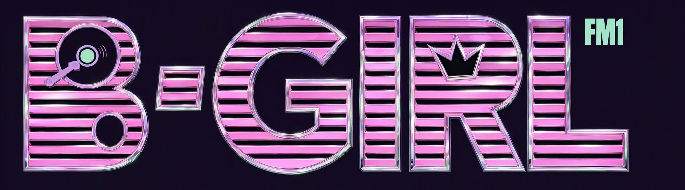
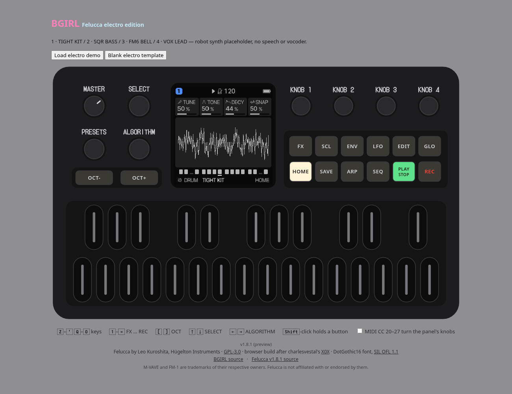

# BGIRL FM-1 — Felucca electro edition

<p align="center">
  
</p>

**Felucca electro defaults + sample-fed vocoder + arp-triggered floorwork.**
Independent GPL-3.0-only derivative of Felucca, not an official Hügelton build.
Browser development milestone only: **do not install on hardware**.

## Play in your browser

**[Launch the live BGIRL synth demo](https://track-forge.github.io/bgirl-fm1/)**

Click **Switch on**, then **PLAY** to hear the electro groove with vocoded speech.
No installation needed. The preview updates automatically after successful main
builds; use **Load electro demo** if a previous session's autosave is restored.



## Run locally

Requires Git, Python 3.11+, C compiler/libm, Node 24, Emscripten **6.0.10**.
Pillow must have FreeType/Raqm support (ordinary Linux wheels do).

```sh
git clone https://github.com/track-forge/bgirl-fm1.git
cd bgirl-fm1
git checkout main
git submodule update --init --recursive
python3 -m pip install Pillow==12.1.1 fonttools==4.68.0
# Install/activate Emscripten 6.0.10 using emsdk; then:
source /path/to/emsdk/emsdk_env.sh
./build.sh --web
./tests/run_tests.sh
python3 -m http.server 8767 --bind 127.0.0.1 --directory felucca/build/emu
```

Open <http://127.0.0.1:8767> and click **Switch on**. Audio needs this user gesture.
The wrapper calls Felucca's own asset generators and `web/emu/build.sh`; no JieLi
SDK, device package, installer, paid service or network-fetched sound is needed.
Build-time fonts and sample sources are bundled upstream with their notices.

If Emscripten is not installed, create a separate SDK checkout (do not clone over
an existing installation):

```sh
git clone https://github.com/emscripten-core/emsdk.git /path/to/emsdk
git -C /path/to/emsdk checkout 708dcbcc9ee23bc7d2dad44fc90db377e38b771c
/path/to/emsdk/emsdk install 6.0.10
/path/to/emsdk/emsdk activate 6.0.10
source /path/to/emsdk/emsdk_env.sh
```

## Battle Circuit visual identity

The fresh-state UI now uses **CIRCUIT**: crisp mint/near-black display, squared
technical cells, reverse-video focus, and a bone/black browser shell. Existing
saved COLOR / STYLE / LARGE / CUSTOM choices are preserved. To opt in on a saved
session, hold HOME → COLOR → CIRCUIT; HOME exits. No musical behavior changes.

[Before/after screenshots, verification and local demo](docs/BATTLE_CIRCUIT_VERIFICATION.md).

## Sample-fed vocoder / early listening demo

Switch on, then **Load dry speech**, **Load8-band vocoder** or **Load12-band
vocoder** below the panel; confirm replacing the current unsaved project. Press
PLAY. The wet setups keep the electro demo drums/bass and use a **track3 GRAIN /
CLOUD PAD (one octave lower)** as track4 speech's carrier, with dry pad monitoring
OFF. The dry-speech
button stays isolated. Saved slots are not erased. Fresh startup and Load electro demo now use this
12-band arrangement; restored autosaves take precedence.

- Track4 chromatic keys select original-speed chops in the demo. The isolated
  dry-speech button still selects the four factory SPEECH phrases.
- Select track3 (ALGORITHM) and play pad/carrier notes without restarting speech.
- Track4 FX pages2–4 (immediately after FX): VOCODER (carrier, bands, wet, dry monitoring), VOC INPUT
  (live HOLD/Freeze, trims, consonants), VOC COLOR (three character groups/release).
  Tap FX **slowly**, or use SELECT after opening FX; quick double-tap locks the
  inherited performance layer, whose FRZ is a different effect.
- MON OFF hides the carrier's direct output/sends while retaining its audio feed.
  Ordinary mute silences the feed. STOP/panic ends speech and live Freeze.
- Expand **reference renders** for dry/8/12/consonant/chorus comparisons.
  These original isolated ANALOG references are not the live pad groove.
  Unnormalized levels differ. Doug reports the overall vocoder experiment is a win;
  a final band preference/intelligibility curation decision remains open.
- Save projects normally. Old saves load with vocoder OFF. New vocoder saves keep
  routing/controls but load unfrozen; VOCALS projects use identity-bound FUNC
  (ordinary SPEECH projects remain FUNB). Old firmware rejects these new formats.
  Sound presets clear project-specific carrier references.

[Contracts](docs/VOCODER_CONTRACTS.md), [verification / exact commands and limits](docs/VOCODER_VERIFICATION.md),
[speech provenance](assets/speech/README.md). No physical-device performance proof.

## Optional whole-phrase / chopped vocal bank

The **Vocal bank** section loads stopped whole-phrase or sequenced-chop auditions,
each dry or through the existing sustained pad vocoder. Normal builds bundle the
**G6 recording and its six chops**, authorized by Doug for public redistribution.
The other five supplied recordings are not bundled. Factory SPEECH is unchanged.
Startup and **Load electro demo** use the two-bar G6 groove, octave-down CLOUD
PAD and 12-band routing in public builds too. An explicit custom bank without G6
uses its first chop group with the same rhythm. Autosaved projects still take
precedence; refresh and explicitly reload the demo to replace an old arrangement.

Normal panel: SLICE → EDIT 1 → SRC **VOCALS**, VIEW **WHOLE** or a parent group
**G1–G6**, START **W01…** / **C01…**. Chromatic keys/MIDI/step notes select entries;
short taps play to the end, newest trigger replaces, STOP/panic ends playback.
Projects/presets retain bank identity and selection; a missing/different bank is
silent (**BANK MISS**), never substituted.

[Packaging, controls and local browser audition](docs/VOCAL_BANKS.md) ·
[UI/storage contract](docs/VOCAL_BANK_CONTRACT.md) ·
[host/browser verification](docs/VOCAL_BANK_VERIFICATION.md).
No warping, tempo fitting, dry overlay or hardware proof.

## Arp Dance — twelve-pose FLOORWORK

Select a track with ALGORITHM; tap **ARP** slowly to cycle **ARP → ARP2 → ARP
DANCE**. **K1 MODE / K2 RATE** edit the existing musical arp; **K3 STYLE** selects
**CRISP / GHOST**, **K4** is unused. ARP2 still owns SWING, PROB, HOLD and ORDER.
Play/hold a key, or enable HOLD on ARP2 and release it. Each accepted arp trigger
advances one pose, once per chord; skipped triggers hold. GHOST keeps exactly the
previous logical pose under the solid current pose. No notes / ARP OFF holds the
picture; internal-clock held arps can dance even with PLAY stopped.

Leave/re-enter or switch tracks: progression follows each track, with no hidden
painting or replay queue. Initialization, project load and inherited all-off/panic
paths reset to pose0/no ghost. STOP resets speech/vocoder tracks through their
existing all-off behavior; other internally clocked held arps keep playing. Style
is session-only, not saved with projects. LARGE preserves the96×96 stage and uses
larger labels. The source has a deliberate hard-cut loop seam, not a seamless video.

[Source, permission,96/64 comparisons, converter and offline preview](assets/dance/README.md) ·
[Implementation plan](docs/ARP_DANCE_IMPLEMENTATION_PLAN.md) ·
[Host/browser evidence and limits](docs/ARP_DANCE_VERIFICATION.md).
No new generation, musical timing/RNG changes or hardware-performance claim.

## Signature Electro · ten original factory sounds

On the normal panel: **PRESETS → LIST (KNOB4) → SIGNATURE**. The collection
appends SUB CLEAN, SUB DRIVE, KICK, SNARE, CLAP, CLOSED HAT, OPEN HAT, IRON STAB,
EL CHORD and CHIRP; legacy kits/presets and all32 user slots remain available.
The browser's **Signature Electro** section also loads these normal factory
sounds onto the selected track. Factory selection applies curated levels;
subsequent user-preset loads retain the normal track mixer settings.

- Subs: mono retrigger, MIDI28–52 (24 also tested), no default space/detune/sweep.
- Standalone drums: every key/MIDI/step note plays the selected identity at fixed
  pitch. TUNE spans ±5st (kick/hats), ±3st (snare/clap). Note-off does not cut
  the decay; STOP/panic/sound replacement clear it. A new hit reuses its lane.
- CLAP fires clap+body on one note, using one shared voice. **EDIT → LANES →
  SNARE level** is its body blend (factory32/127); TONE/DECY/SNAP remain useful.
- Hats: **KIT CH G1 / OH G1** opt into shared group1. Closed chokes open across
  tracks, including simultaneous hits; open never kills closed. **CH FREE /
  OH FREE** opts out. Legacy kit choke behavior is unchanged.
- FM6: **MLVL** is modulation brightness, not a resonant filter. **OP ENV** owns
  amplitude/decay/release; common ADSR is not the FM6 amplitude envelope. CHIRP's
  patch pitch envelope falls9semitones to root in139ms. EL CHORD expands one
  live root to minor/+oct (four tones), six voices/track maximum.

**Signature blank template**, **demo A · kit + voices**, **demo B · standalone**
and **hat choke audition** replace the unsaved project only after confirmation,
load stopped, and keep saved slots. PLAY starts the editable demo. Startup and
Load electro demo still use the vocal arrangement; autosave still takes priority.
FM6 MIDI PC0–7 and bank PC8–39 retain their meanings; Signature factory voices
append at40–44. DRUM PC0–8 retains kits;9–15 selects standalone modes.

New standalone projects use guarded **FUND** (including vocal fingerprints), and
standalone sound presets use versions7/8. Older firmware rejects them; old project
readers and ordinary save formats remain. No manual user-slot installation needed.

[Versioned original recipes](assets/signature/manifest.json) ·
[Implementation contract](docs/SIGNATURE_ELECTRO_BANK_PLAN.md) ·
[Verification, local audition and reproducible recordings](docs/SIGNATURE_ELECTRO_BANK_VERIFICATION.md).
**Doug's listening approval is pending for every family.** Host/browser checks do
not establish musical approval or physical-device fit/performance.

## Starting demo and blank palette

| Track | Sound | Pattern |
| --- | --- | --- |
| 1 | DRUM / TIGHT KIT | Original 16-step kick, snare+clap, hats and bell |
| 2 | ANALOG / SQR BASS | Upstream OFFBEAT, mono legato bass |
| 3 | GRAIN / CLOUD PAD | C2/G2 tied through each phrase; carrier, dry MON OFF |
| 4 | SLICE / VOCALS | Two-bar (32-step) chop groove; bundled G6 → 12-band vocoder, carrier T3 |

Fresh browser state loads this editable demo **stopped at 120 BPM**. A valid
last-session autosave takes precedence. All engines/presets remain selectable;
this is a curated starting palette, not a restricted instrument. Shared upstream
voice limits still apply. Doug accepted the sustained-carrier vocoder audition as a win; physical performance remains unverified.

**Load electro demo** and **Blank electro template** replace only the current
unsaved project, after confirmation. Both use Felucca's project reset/sound-load
machinery, stop transport, release voices and preserve saved slots/user presets.
The blank template retains the original TIGHT KIT / SQR BASS / FM6 BELL / VOX LEAD
palette with no steps or vocoder routing. Normal Felucca MENU > SYSTEM
> CLEAR ALL retains its original factory defaults; it is not the BGIRL template button.

### Short demo recipe

1. Switch on fresh (or explicitly Load electro demo). Start with low MASTER; press PLAY.
2. Turn **ALGORITHM** (keyboard ←/→) to select each of the four tracks.
3. Play Z–' / Q–O keyboard notes; release them. Drag/scroll the labeled knobs;
   focused knob arrows also work. SELECT browses pages, PRESETS browses sounds.
4. Stop with PLAY. Edit a sound and use Felucca **SAVE**, **OCT+**, **OCT+** to
   confirm a user preset. Use its normal SAVE > PROJECT page to save/load a project.
5. On track4, tap FX slowly twice for VOCODER: CARR=T3,12bands,MON OFF.
   MON ON adds the dry pad; mute T1/T2 (not T3) for a clearer voice audition.
6. Use Blank electro template, edit or load saved material, then optionally reload
   the demo. Autosave restores changed music after at least 10 quiet seconds and
   the inherited 60-second write-spacing limit; a page reload immediately after an
   unsaved edit is **not** a guaranteed save.
6. Stop, release keys and let effect tails decay. No prototype HOME-panic/ARP-start
   remappings: these are Felucca's normal controls. Read its [manual](https://github.com/hugelton/Felucca/wiki/Home).

Portrait uses upstream's tall responsive panel. Desktop/mobile screenshots and
verification details: [build status](docs/BUILD_STATUS.md).

## Architecture, history and licensing

- Active instrument: `felucca/`, ancestry-preserving import of **v1.8.1**. Upstream
  v1.8.2 removed browser support; it is intentionally not this baseline.
- Exact pins, license inventory and small upstream delta: [provenance](docs/UPSTREAM.md).
- Browser flash key `bgirl-felucca-v1-flash` isolates this edition from stock
  Felucca and the retired prototype. Same Felucca data formats; no device/prototype migration.
- Prototype source, original speech, vocoder and tests remain reachable at
  [`4cc1e11`](https://github.com/track-forge/bgirl-fm1/tree/4cc1e11e50ffb1d2a06a50547780b9e828a8b15f).
  [Prototype build evidence](docs/PROTOTYPE_BUILD_STATUS.md) and
  [voice findings](docs/VOICE_SPIKE.md) are historical, not shipping features.
- GPL-3.0-only combined derivative: [LICENSE](LICENSE), upstream
  [credits](felucca/CREDITS.md), [licensing](felucca/LICENSING.md) and
  [component texts](felucca/LICENSES). Engines retain MIT; BSP retains MPL-2.0;
  fonts and CC0/other assets retain their notices. `LICENSE.upstream` is the old
  prototype's MPL notice, **not** the license of this combined application.
- The graffiti wordmark has separate [provenance and use terms](assets/branding/README.md).
  It is not covered by the repository GPL license; commercial brand use requires
  separate review/licensing under the originating Qwen Image 2.1 workflow terms.
- Vocoder sound approval/target validation, [silhouette dance page #2](https://github.com/track-forge/bgirl-fm1/issues/2),
  device identity/storage review and physical MIDI/clock/performance testing remain follow-ups.
  The [Arp Dance implementation plan](docs/ARP_DANCE_IMPLEMENTATION_PLAN.md) scopes
  one twelve-pose move and CRISP/GHOST rendering on an arp-owned page; implemented
  with browser/host evidence above, device validation still deferred.

## GitHub Pages preview

The root `host.yml` workflow builds the browser instrument and runs host plus
Chromium AudioWorklet checks on pushes and PRs. After a successful **main** build,
it uploads only `felucca/build/emu` and deploys via GitHub Pages. PRs and other
branches never deploy. Manual Actions runs also deploy only when run on main.
No hardware firmware, installer or release is published.

One-time repository setup: **Settings → Pages → Build and deployment → Source:
GitHub Actions**. The `github-pages` environment must allow main deployments.
Expected URL (unless a custom domain is configured):
https://track-forge.github.io/bgirl-fm1/ . The deployment job reports the actual
URL. HTTPS is required for AudioWorklet outside localhost. No token secret needed;
only the deploy job receives `pages:write` / `id-token:write`.

CI tests the `/bgirl-fm1/` prefix so WASM, worklet, font and listening-file paths
remain project-site-relative. `build.json` records the published commit and source
URL, and `LICENSE` accompanies the build. Check that revision when reporting bugs.
The existing local browser autosave is origin-specific; old saved work on the same
origin remains unchanged after a deployment. Explicitly load a demo to adopt new
demo defaults.

This workflow is a preview deployment, not hardware-performance proof. Imported
upstream workflows under `felucca/.github` remain inactive; do not enable their
release or installer destinations.
