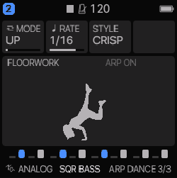
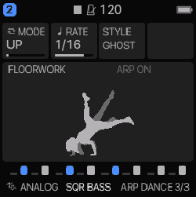
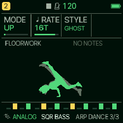

# Arp Dance — host/browser verification

2026-11-16. Implementation source **9f297c88a60b79a8c0cfd13e115a912005ce7ad4**.
A subsequent documentation-only commit records this evidence. Based on fresh main
`fc937514d8799dfd554cc466bbe269f195226513` (includes vocal-bank PR14), then plan
PR15's unmerged docs commit cherry-picked as15bb9e9. No dependency pin changes.
This is a browser/host milestone, **not a hardware performance or fit proof**.
Tools: GCC15.3.1, Python3.14.5, Node24.22.1, Emscripten6.0.10;
Pillow12.1.1/fonttools4.68.0 for normal build assets. Offline FFmpeg7.1.5.

## Delivered contract

- One FLOORWORK move, twelve source-order silhouettes;96×96/13,824 raw bytes.
  [Conversion/rights/framing/64px comparison/seam/replacement](../assets/dance/README.md).
  Explicit public-derived-art authorization from Doug recorded2026-11-16.
- Normal selected-track ARP family: ARP → ARP2 → ARP DANCE. K1 existing MODE,
  K2 existing RATE, K3 session-only CRISP/GHOST, K4 unassigned. No `P_COUNT`, project,
  preset or flash-layout change. Blank/old projects inherit the same musical state.
- One accepted `arp_fire` event advances one pose before its CHORD branch: CHORD
  advances once, rejected probability does not. The inherited `rng()&127 <= PROB`
  test means PROB0 can still accept occasionally; it was not silently rewritten.
  A fresh chord can reset musical `arp_idx` without resetting visual progression.
- Four aligned lock-free atomic32-bit snapshots (16B), core0-owned writes from
  sequencing and existing all-off/reset boundaries. A whole snapshot holds current,
  previous, previous-valid and started bits. Relaxed atomic load/store publishes
  no other memory. No `volatile`-only synchronization, CAS retry, locks/waits,
  graphics, decoding, allocation or extra RNG in the producer. No worker writes.
  A compile-time assertion refuses a non-lock-free32-bit implementation; actual
  target-toolchain support/disassembly remains unverified.
- UI loads once for signature **and** pixels, coalesces skipped paints directly to
  the newest current/previous pair. No history queue/replay. Only the visible DANCE
  graph includes the snapshot in invalidation. CRISP restores the complete old
  graph region. GHOST paints one previous logical pose dim first, current solid
  last; no timed fade. `cv_begin`/`cv_blit` retain existing LCD DMA synchronization.
- Stage96×96 at screen(72,98), within existing240×122 graph. LARGE uses label-only
  mode, keeping the stage instead of reducing it to a title strip. No overlap with
  controls/header/footer; all original input/overlays remain available.

### Reset semantics (without changing musical resets)

`felucca_init` resets each track at initialization. `project_restore_runtime`
resets all snapshots under its existing audio-ISR exclusion (also used by NEW,
load and explicit browser blank/demo). `trk_all_off` resets the affected snapshot:
panic/engine/preset requests, MIDI all-off/overflow recovery, worker-failure recovery
and any inherited call sites. In particular STOP already invokes all-off for
bundled speech/vocal/vocoder SLICE tracks; their visual state therefore resets.
Ordinary key release/gate expiry, ARP OFF and ordinary transport on other tracks
hold the pose; an internally clocked held arp can continue while sequencer PLAY is
stopped. External START/STOP/CONTINUE follow inherited MIDI-clock behavior. Page
entry/track selection never reset; no ghost leaks between tracks. Style remains
session-global across project loads, and returns to CRISP only at a new session.

## Exact commands and outcomes

Baseline (plan-only worktree at15bb9e9), before runtime changes:

```sh
source /home/dev/.local/share/bgirl-emsdk/emsdk_env.sh
./build.sh --web
./tests/run_tests.sh
```

PASS: baseline WASM870,847B; upstream UI/input/storage/persistence/MIDI/swing,
98 unchanged goldens,88,200 identical native/WASM frames and existing BGIRL,
vocoder, dual-core failure and vocal-bank tests. Receipt files:
`/tmp/bgirl-dance-baseline-{build,tests}.log`.

Implementation at the source revision above:

```sh
./build.sh --web
./tests/run_tests.sh
# Included by run_tests.sh, independently repeatable:
./tests/run_dance_tests.sh
```

PASS (full selected host matrix, no rewritten audio goldens):

- Ten upstream suites: storage, upreset, input, midi_uart, project, persistence,
  ui, midi_control, midi_drift, swing.98 unchanged golden renders; zero health/
  voice-routing failures.88,200 native/WASM heavy-song frames identical.
- Existing BGIRL startup/blank/engine/knobs/transport/persistence checks, vocoder
  signal/clock/routing/recovery tests, disabled-vocoder builds,336+182+112 ordered
  pair/split comparisons and60 rejected/partial/completed worker failure cases.
  Eight vocal packager tests and public fixture vocal-bank lifetime/identity/
  sequence tests. Physical CPU counters remain zero on host, not budget proof.
- Accepted/rejected/empty triggers, first pose and27-trigger wrap/coalescing,
  four-note CHORD once, HOLD/key release/gate off, ARP OFF, stopped internal arp,
  track isolation and initialization/project/panic/all-off resets.
- Real firmware USB-MIDI queue: external START/pulses advance, STOP/pulses hold,
  CONTINUE/pulses resume. Browser's inherited Web MIDI interface handles channel
  messages only; **external realtime clock was host-tested, not browser/hardware**.
-480 exact96×96 pixel compositions (10 palettes × FLAT/LINE ×12 poses ×2 styles):
  foreground intersections win, old ghost pixels clear, previous logical pose
  survives skipped paints, reset removes ghost. LARGE preserves graph geometry.
-1,000 triggers/100 paints →100 graph blits;100 idle attempts →0;25 hidden dance
  updates →0 extra graph blits. Per changed graph:58,560 RGB565 pixel bytes.
-512,000 stereo frames plus4,000 RNG-state/note snapshots **byte identical** across
  compile-disabled telemetry, hidden page, CRISP and GHOST; actual four-track demo
  with vocoder, RANDOM arp, probability and swing. No musical timing/RNG rewrite.
-1,000,000 producer trigger/reset updates with concurrent coherent snapshot reads;
  all packed-state invariants hold. Host pthread stress, not a target race detector.
- Normal panel/project wire round trip retains arp MODE/RATE; project load resets
  progression without serializing style. Track1856B and project store3840B unchanged.
- Two pack integrity tests: all12 masks unique at both sizes, manifest hashes,
  packed bit/row order and committed header/binary equality. Independent offline
  conversion of the real MP4 reproduced all generated files byte-for-byte.

One initial regression run failed four SLICES assertions because the UI test's
random-page soak left its cursor in `sp` across simulated power-ons. Adding a page
changed that random path; the harness now resets `sp` as real power-on does (plus
new transient dance fields). No production SLICES behavior or golden was changed.
An initial missing help-keycap syntax was corrected, not waived. A first external
clock test mistakenly called channel-only `web_midi`; corrected to the real USB
queue for realtime packets, with no browser MIDI behavior expansion.

### Actual Chromium acceptance

Serve only locally (not a manual deployment):

```sh
python3 -m http.server 8775 --bind 127.0.0.1 --directory felucca/build/emu
# Another terminal; use your installed Playwright/Chromium, or workspace paths:
export PLAYWRIGHT_MODULE=/home/dev/.openclaw/npm/projects/askjo-camofox-browser-2f55486f67/node_modules/playwright-core
export CHROMIUM_PATH=/home/dev/.cache/ms-playwright/chromium-1228/chrome-linux64/chrome
export BGIRL_URL=http://127.0.0.1:8775
node tests/browser-smoke.cjs
node tests/vocoder-browser.cjs
node tests/vocal-browser.cjs
node tests/dance-browser.cjs
```

All four suites PASS, **zero page errors**. Real AudioWorklet and inherited panel:
all ARP pages/cycling, track2 MODE/RATE, ARP2 swing/probability/HOLD, key down/up,
style, hidden progression/re-entry, track isolation, no-notes stationary, transport
while internal HOLD continues, full electro groove/vocoder plus rapid arp in both
styles, normal project save, mobile, reload/session style reset. Existing suites
also verify changed sound/project restores, dry/wet vocals and all five listening
reference files. Read-only `dance-info` diagnostics never mutate music or painting.

Desktop1300×1100, portrait390×844 and actual240×240 panels inspected:





[Full desktop](img/arp-dance/crisp-desktop.png) ·
[Full mobile](img/arp-dance/mobile.png) · [Browser result](img/arp-dance/results.json).
No mobile horizontal overflow. Hand/forearm gaps survive at96;64 is more collapsed.
Ghost is subdued rather than another bright dancer. Seam is an intentionally
exposed hard cut, not claimed seamless. Offline standalone `file://` preview also
passed style/seam/fast-loop checks with zero page errors.

Example browser worklet self-load samples during groove/vocoder/rapid arp:
CRISP2.67–2.87%, GHOST2.97–4.46% (stored result; varies by headless scheduling).
These are a few diagnostic samples, **not** a benchmark, worst-case deadline,
human listening test or target xrun/SPI proof. UI follows existing15ms firmware
frame schedule; browser publishes at30Hz. Triggers coalesce, never backpressure
music. Static/hidden snapshots do not create a dance redraw timer.

## Measured resource deltas (host/browser only)

| Resource | Baseline | Dance | Delta / interpretation |
| --- | ---: | ---: | --- |
| Runtime raw96 mask bank |0 |13,824B |+13,824 read-only; ghost reuses it |
|64 comparison raw file |0 |6,144B |not linked |
| Telemetry/UI cache/style |0 |16+4+1B |+21 logical mutable bytes; linker alignment is target-specific |
| Native `size` text+rodata |765,429 |779,965B |+14,536B (GCC O1 test executable) |
| Native initialized data |1,572 |1,572B |0 |
| Native BSS aggregate |1,593,920 |1,593,920B |0 aggregate, new21B fits existing alignment gaps; not zero logical state |
| Track / project wire |1,856 /3,840 |same |0 |
| Existing canvas |59,520 |59,520B |0 new framebuffer/scratch |
| WASM |870,847 |881,845B |+10,998B |
| WASM initial linear memory |33,554,432 |33,554,432B |unchanged fixed allocation; not target RAM |
| Changed graph pixel transfer |58,560 |58,560B |same graph area; more graph updates while dancing |

WASM SHA-256:
`ca884a6b74e6ff4e97e63f288c5e0bc7c9226e6df998eed53d3bdf1c78bad041`.
Baseline SHA:
`01f7c11bfaeeaa95da29f39300d7a63d3c3a95f83856e87a2f93ca2bf076c52b`.
Native aggregate measured with `size` on the same `tests/bgirl_test.c` at main
fc93751 versus implementation, same generated public fixture, compiler/options.
Metadata/page/help descriptors and strings are additional read-only data included
in native/WASM totals; `nm -S` shows PAGES+16B and HELP_PAGE+16B on this64-bit host.
No target linker-map estimate is inferred from these figures.

## Browser demo recipe

1. Build and serve as above; Switch on. Keep master low; load electro demo if needed.
2. Select track2 with ALGORITHM. Tap ARP slowly three times to ARP DANCE.
3. K1 UP (or CHORD); play/hold keys. K2 changes the **musical** pose-trigger rate.
4. ARP cycles to ARP, then ARP2: K3 HOLD on; release keys. K1 swing/K2 probability
   remain musical controls. ARP returns to DANCE. K3 selects GHOST, left CRISP.
5. Leave HOME and return ARP; switch tracks and back. No replay, wrong-track ghost
   or free-running no-note animation. PLAY adds/removes the editable demo groove.
6. Turn HOLD off on ARP2 and release keys; pose holds. Existing panic/all-off or
   project reload resets to0/no ghost. Save/load normally; style is not persisted.
7. Open assets/dance/preview.html to scrutinize the hard-cut11→0 seam independently.

## Remaining device gates / explicit exclusions

**Not run:** device compile/flash, target atomic instruction audit, linker/RAM/flash
fit, physical USB/TRS MIDI, LCD transfer timing/tearing, audio deadlines/latency/xruns,
worst-case UI+audio interrupt nesting, or human sound/seam approval. Existing
screen-reader parity limitations remain. No hardware-readiness inference.

No merge, tags/releases, device build/flash, pin updates or manual public/tailnet
preview deployment. PR CI adds the dance browser test to the existing local
project-prefix check; only existing main-only workflow deployment can publish.
