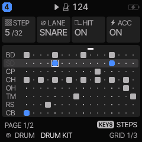
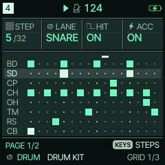
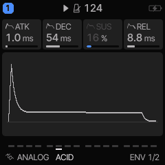
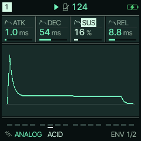
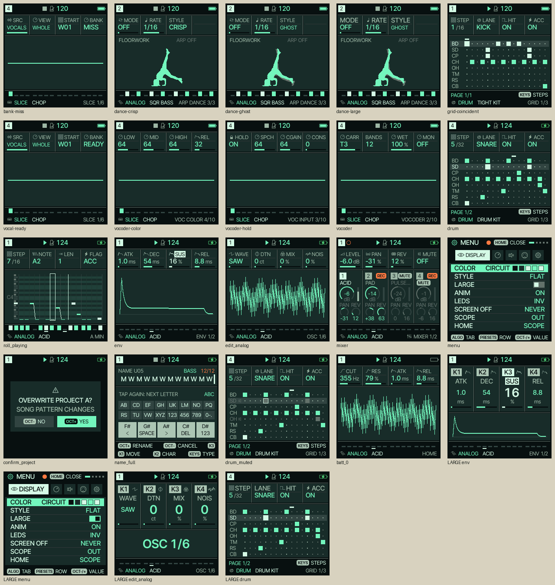

# Battle Circuit — implementation and evidence

Date: 2026-11-16. Implementation: `082acd3` + LED calibration follow-up `6c57888`.
Initial captured baseline: main `7f36cdf7c09221342c46d0dd52f6c63bbdfcd48d`.
Final integration base: main `751c708054c4bd8b8168de8047e86e22f8845387`, including
branding PR #19, which landed during implementation. Rebased and retained its
selected wordmark, asset/provenance files, marketing copy, Play/source CTAs and
image build-copy path. The original PNG is unchanged; CSS displays it in grayscale
on bone so acid lime is not the defining shell accent.
Plan: [BATTLE_CIRCUIT_UI_PLAN.md](BATTLE_CIRCUIT_UI_PLAN.md), brought from
planning commit `647c3f4`; PR #18 remains plan-only. **Host/browser evidence only.**

## What changed

- Appended **CIRCUIT** at built-in palette index **10**, tagged ID **74**. Existing
  indices 0–9, the twenty legacy mappings, CUSTOM's separate flag/bytes, storage
  key, formats and migration paths are unchanged. Fresh/invalid settings choose
  CIRCUIT; valid restored settings win. Choose MENU → COLOR → CIRCUIT to opt in on
  an existing browser session. Nothing silently recolors an existing saved palette.
- CIRCUIT has near-black/mint tokens, bright text, and sparse orange REC/warnings.
  Square cards, graphs, menus/dialogs/name cells, thin register/divider rules and
  reverse-video hot-knob labels share the existing four-column layout. FLAT keeps
  its filled surfaces; LINE keeps its unfilled surfaces. Other palettes retain
  their original geometry and colors, including user-custom colors.
- Browser shell: bone/black typography, selected wordmark, BG–01 catalog plate, section identifiers,
  square control/key wells, coordinated LED colors and visible keyboard focus.
  Panel positions, hit-target bounds, pointer/keyboard/MIDI handlers, power gesture,
  references, bank/demo controls and credits are retained.
- No musical, DSP, sequencer/arp/RNG, routing, sample, project-schema, storage-key,
  pin, workflow or publishing changes. Vocoder and FLOORWORK use their existing
  controls and data; no decorative fake telemetry or new audio-path work.

## Screenshots

Real Chromium AudioWorklet captures, not mockups. Browser screenshots are full-page;
phone viewport was **390×844**, desktop **1300×1000**. The native screenshots and
matrix tiles are **240×240**; browser scaling is not native pixel evidence.

| Before (initial main / default GREY) | After (CIRCUIT + merged wordmark) |
| --- | --- |
| [Desktop](img/battle-circuit/before-desktop.png) | [Desktop + keyboard focus](img/battle-circuit/after-desktop.png) |
| [Portrait](img/battle-circuit/before-mobile.png) | [Portrait + keyboard focus](img/battle-circuit/after-mobile.png) |
|  |  |
|  |  |



Matrix covers vocoder/HOLD/MON, vocal READY/MISS, dance CRISP/GHOST/LARGE, drum
selection coincident with playhead, muted lane, piano roll, synth/envelope, mixer,
menu, confirmation, full twelve-character name warning, and LARGE pages. Long
names, negative values and units use existing font fallback/fit paths. The ghost
is the previous logical pose, not a time fade. The existing outlined cursor versus
playhead/filled notes and textual OFF/MISS/REC cues remain; hue is not the only cue.
The browser suite checks the wide catalog mark against knob labels; the redundant
phone-panel inscription is omitted to leave those labels clear.

## Validation results

All following commands passed locally (activate Emscripten 6.0.10 first):

```sh
./build.sh --web
./tests/run_tests.sh
python3 felucca/tools/gen_ui_palettes.py --report
git diff --check
```

Baseline: the same build/root suite and browser smoke passed before source edits.
The first build attempt lacked `emcc` on PATH; sourcing the existing SDK fixed it,
without installing/updating dependencies. No pre-existing test failures remained.

- **98 audio goldens unchanged**, no health/voice/routing failures; **88,200 native
  versus WASM frames bit-identical**.
- Vocoder normal/disabled, whole/chopped vocals, project/preset/save/load, MIDI,
  key release, panic/STOP, backup and clock tests pass in the root suite.
- Dance: **528 compositions** (11 palettes × FLAT/LINE × 12 poses × CRISP/GHOST),
  512,000 stereo frames + 4,000 RNG/note snapshots unchanged versus disabled
  telemetry; hidden/idle graph behavior and concurrent snapshot checks pass.
- New Battle Circuit host check: actual fresh boot selects CIRCUIT; **44**
  palette/style/LARGE combinations round-trip byte-identically; **20** legacy IDs
  map as before; original palette names/indices and CUSTOM colors/flags round-trip;
  unchanged graph adds no idle drawing. Appending a palette does not reinterpret
  the saved custom-palette index: CUSTOM activation lives in its existing flag.
- The LED-breath check caught hard-coded old cream/white endpoints and
  uncalibrated replacement peaks. Corrected mint peaks preserve the original
  firmware-relative **0.80 HI / 0.58 LO** levels; the test now reads current lit
  colors from the source CSS and keeps its original **0.06** tolerance.
- RGB565 contrast generator passes every palette's existing thresholds. CIRCUIT:
  body text/background **17.1:1**, secondary labels/surface **6.7:1**,
  values/surface **10.9:1**, selection text **9.5:1**, REC-chip text **10.5:1**.
  Muted structural marks are not essential text. Browser ink/bone and mint/black
  remain high contrast; an unlit LED is not the sole control label.

Native layout audit (same upstream lint, no rebaseline):

```sh
mkdir -p local/acceptance/after/ppm
cc -O1 -w -ffp-contract=off \
  -Ifelucca/firmware/hal -Ifelucca/firmware/bsp/chip \
  -Ifelucca/firmware/bsp/boards/fm1 -Ifelucca/firmware/src \
  -Ifelucca/build/gen -o felucca/build/host/ui_render felucca/tests/ui_render.c -lm
felucca/build/host/ui_render local/acceptance/after
python3 felucca/tests/ui_render.py local/acceptance/after
mkdir -p local/acceptance/after/features
felucca/build/host/battle_ui_test local/acceptance/after/features
```

- Before: **233 scenes × 10 palettes**, plus FLAT/LINE/LARGE and page/value sweeps;
  **0** lint findings, **0** invisible ink, **0** gray/mono defects, **0** alignment
  errors over **3,879,171** measurements.
- After: **233 scenes × 11 palettes**, same sweeps; **0** lint findings, **0**
  invisible ink, **0** gray/mono defects, **0** alignment errors over **3,904,736**
  measurements. The new palette adds output, not a lowered acceptance threshold.
  Existing deliberate free-name/message ellipses are reported, not clipping errors.

Actual Chromium (local server running as below):

```sh
# If not installed normally, set PLAYWRIGHT_MODULE and CHROMIUM_PATH.
export BGIRL_URL=http://127.0.0.1:8781
BGIRL_ARTIFACTS=local/acceptance/final/battle node tests/battle-browser.cjs
BGIRL_ARTIFACTS=local/acceptance/final/smoke node tests/browser-smoke.cjs
BGIRL_ARTIFACTS=local/acceptance/final/vocoder node tests/vocoder-browser.cjs
BGIRL_ARTIFACTS=local/acceptance/final/vocal node tests/vocal-browser.cjs
BGIRL_ARTIFACTS=local/acceptance/final/dance node tests/dance-browser.cjs
```

All five pass with **zero page errors**: actual audio output and quiet STOP/release,
transport, tracks, parameter edit, confirmation cancel/accept, preset/project
save/load, bank dry/wet, vocoder dry/8/12, references, ARP family/HOLD/hidden
progression, CRISP/GHOST and restored alternate palette/LINE/LARGE.
The dedicated responsive check finds all **49 panel targets inside the panel**,
no horizontal overflow, and visible focused-knob keyboard edits on both viewports.
Panel targets retain the inherited sizes (smallest portrait target approximately
21×27 CSS px); they were not shrunk, and this is not a claim of a new 44px piano
keyboard. External audition buttons are at least 44px tall in portrait.

## Size, assets and redraw limits

- Public-fixture baseline WASM **881,845 bytes** → **882,277 bytes**, **+432 bytes**.
  Final SHA-256: `b61a53baad50dd785b29905bfa445a67e4985f62bf74c71a31daf4284d353f45`.
- No newly generated font/artwork, image generator call or licensed-asset download.
  Firmware retains bundled Inter Tight/Fukiai and existing OFL/component notices;
  knob labels retain bundled DotGothic16/OFL. Shell masthead retains main's selected raster wordmark unchanged, with a CSS-only grayscale treatment;
  its separate [provenance/use terms](../assets/branding/README.md) still apply.
  No proprietary font file is bundled.
  Numeric firmware text remains the existing compact Inter Tight, not a newly
  rasterized monospace font. This avoids a font budget/glyph-coverage regression.
- The skin uses cached palette tokens, existing strips and existing graph signatures.
  It adds no framebuffer, per-pose work, audio telemetry or full-screen repaint loop.
  Square fills remove rounded-corner work in CIRCUIT, but no target timing saving
  is claimed. Host/browser behavior does not establish FM-1 RAM/CPU/display quality.

## Local demo

```sh
git checkout feat/battle-circuit-ui
git submodule update --init --recursive
# source /path/to/emsdk/emsdk_env.sh
./build.sh --web
python3 -m http.server 8781 --bind 127.0.0.1 --directory felucca/build/emu
```

Open **http://127.0.0.1:8781**, Switch on, PLAY. Existing restored settings remain:
hold HOME → COLOR → CIRCUIT (K1/OCT+) to opt in; PRESETS selects STYLE/LARGE rows.
HOME exits. Try SEQ for the drum grid; ALGORITHM selects bass, ENV shows its envelope.
Track 4 → FX twice slowly shows VOCODER. On bass, ARP three slow taps reaches
ARP DANCE; K1 enables a mode, hold/play a key, K3 chooses CRISP/GHOST. Stop afterward.
Public fixture only; no private vocals are required or included.

For a remote browser, forward localhost (WebAudio requires a secure context):

```sh
ssh -N -L 8781:127.0.0.1:8781 dev@openclaw-fedora.tail549b77.ts.net
```

Then open your own http://127.0.0.1:8781. This work did not change any tailnet
proxy, public Pages site, existing audition service or deployment. No hardware
build/flash, merge, release or public deployment was performed. Human aesthetic
review and physical display/audio/timing acceptance remain separate.
