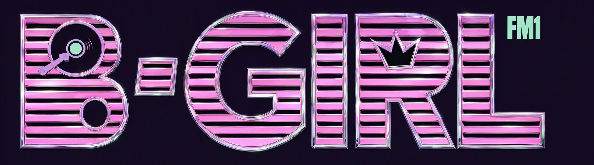

# Chrome branding (#47): review plan and evidence

## Scope and plan

1. Preserve the exact selected JPEG and document truthful provenance/rights.
2. Decode a local browser/README PNG without recoloring or changing aspect ratio.
3. Use the dedicated simplified transparent LCD master for boot only; preserve
   the full chrome README/browser logo. No engine, timer, DSP or storage edits.
4. Build browser WASM, run root host suite, inspect real Chromium at desktop/mobile
   and its first native240×240 boot framebuffer, then open a main-target PR.

## Visual review

README artwork (same decoded master as the browser header):

Actual native C renderer framebuffer,240×240 (not composited art or a device photograph):

[4× nearest-neighbor boot](img/boot-native-large.png) ·
[Light PAPER](img/boot-PAPER_boot.png) · [Custom background](img/boot-CUSTOM_boot.png)

[Desktop browser](img/chrome-desktop.png) · [Mobile390×844](img/chrome-mobile.png)

## Cost and boot behavior

The unchanged master is161,130 bytes; PNG is878,674 bytes (browser/README only).
Firmware references only the dedicated216×58,16-index boot header: **6,312
bytes**, down5,384 bytes from the rejected11,696-byte chrome boot. The32-row
renderer still uses its existing canvas,64-byte local color cache, one sync,
and no allocation. There are12,528 pixel visits. No new boot delay/timer.
Clear pixels blend to the current palette background; no backing rectangle.
Tight foreground bounds are x12..227/y91..148, centered within one pixel.
GREY/MONO retain conversion. Static costs and native/browser proof do not
establish device memory maps, timings, physical readability or licensing.

## Limitations

Human visual approval (including native-size record/crown and FM1) is pending.
No device build/flash, performance, physical display or hardware-fit claim.
No merge or shared/deployed-site update authorized: Pages remains at its existing
main revision until a separately authorized merge. Local project-prefix loading
is evidence for this PR, not proof the public Pages site serves this change.
Artwork/model commercial reuse and chrome-reference rights remain unresolved;
see [provenance](../assets/branding/README.md). No permissive license is invented.
MCP-backed work was unavailable in this run; implementation, browser and GitHub
verification use local tools/gh, not a claim of configured MCP success.

## Boot repair checks and reproduction

- `./build.sh --web` with Emscripten6.0.10: PASS,1,073,434-byte WASM
  (tool-specific build cost, not device firmware size).
- `python3 tests/test_package_logo.py`: deterministic hash-guarded packing,
  binary alpha with significant clear area, tight216×58 bounds and small mint
  FM1 retention. The previous opaque asset fails these regressions.
- `./tests/run_boot_tests.sh .powderline/boot-followup`: actual native
  `draw_splash`, all12 stock palettes plus custom background; every clear
  framebuffer pixel equals `T_BG`, foreground bounding box centered within1px,
  substantial clear/foreground coverage and existing monochrome checks.
  Captures are raw240×240 native framebuffer exports, converted losslessly to
  PNG; enlarged view uses nearest-neighbor only. No image-composited proof.
- `node tests/splash-browser.cjs`: first actual AudioWorklet framebuffer,
  exact packed pixels/clear background, original boot transition,49 panel targets,
  no desktop/mobile overflow or page errors.
- `node tests/browser-smoke.cjs`: real instrument startup and behavior checks.
- Root `./tests/run_tests.sh`: final result recorded in PR follow-up receipt;
  includes the new native boot regression. No audio goldens rewritten.

Use the README local server recipe; set BGIRL_URL, PLAYWRIGHT_MODULE and
CHROMIUM_PATH as needed. Native proofs above use C `ui_render.c` and the actual
firmware strip renderer, not only packaging or a source-art study. Browser chrome
and README artwork are unchanged. Public Pages and shared services are unchanged.
Human review of the native-size FM1/crown/record and edge quality remains required.
