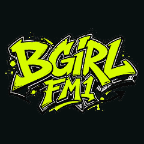

# Centered, transparent logo-only splash

Base: main `1575872e50d5629a234959f2a651ff5c73134ff7` (merged PR #23).
Date: 2026-11-16. Host/browser evidence only.

## Changes

- Only the existing BGIRL logo appears on the splash: **no captions, credits,
  version text or backing rectangle**. Attribution remains in the browser footer,
  About/source and repository notices.
- The unchanged 224×145 artwork is centered at **x=8, y=47** on the 240×240 screen:
  8px margins left/right, 47px above/48px below (nearest pixel for an odd height).
- RGBA quantization preserves transparency and antialiased edges. A 16-entry alpha
  table blends colors with the current palette's **single screen background**;
  no particular background is baked into the artwork. GREY/MONO stay grayscale.
- Original PNG/checksum/provenance and separate artwork use terms are unchanged.
  No new artwork generation, extra framebuffer/allocation, boot timing, audio,
  demo, saved settings, dependencies or publishing changes.

## Before / after

| Previous logo splash | Centered logo only |
| --- | --- |
|  |  |

Native 240×240 captures. The after image comes from the **first actual Chromium
AudioWorklet framebuffer**, without altering splash duration or adding an overlay.

## Verification

```sh
./build.sh --web
./tests/run_tests.sh
python3 tests/test_package_logo.py
git diff --check
```

- Full host suite passes, with **98 unchanged audio goldens** and **88,200
  native/WASM frames bit-identical**. Two packaging tests cover determinism,
  unchanged-source guard, bounded packing and transparent/partial-alpha preservation.
- Updated native layout audit covers **233 scenes × 11 palettes**, LINE/LARGE and
  value sweeps. Exact splash image placement and background-only pixels outside
  the centered rectangle are checked, as is the absence of splash text.
- Actual Chromium splash check verifies **32,480 composited logo pixels**, including
  **10,595 fully transparent pixels**, and **25,120 background-only pixels outside
  the logo rectangle**. No text or plate can occupy that area. Normal boot transition,
  49 panel targets, desktop/390×844 portrait, no overflow and zero page errors pass.
  Normal browser audio/edit/save/reload/STOP smoke also passes.
- Packed image/color/alpha data: **16,288 bytes** (16 bytes more than the opaque
  representation). Local public-bank WASM: **918,843 → 916,060 bytes**.
  SHA-256: `db100f89ac83b1fb9d04a8761bd52bfdfad69e8239784da07852ad2052a3100a`.

Optional native audit commands are in [Battle Circuit verification](BATTLE_CIRCUIT_VERIFICATION.md).
No physical-device display/performance claim or hardware build/flash.

## Local demo

```sh
python3 -m http.server 8783 --bind 127.0.0.1 --directory felucca/build/emu
export BGIRL_URL=http://127.0.0.1:8783
node tests/splash-browser.cjs
node tests/browser-smoke.cjs
```

Open http://127.0.0.1:8783 and **Switch on**. Remote WebAudio needs HTTPS or a
localhost SSH forward. Existing preview services, tailnet proxies and public site
are untouched; this PR is not merged or deployed.
