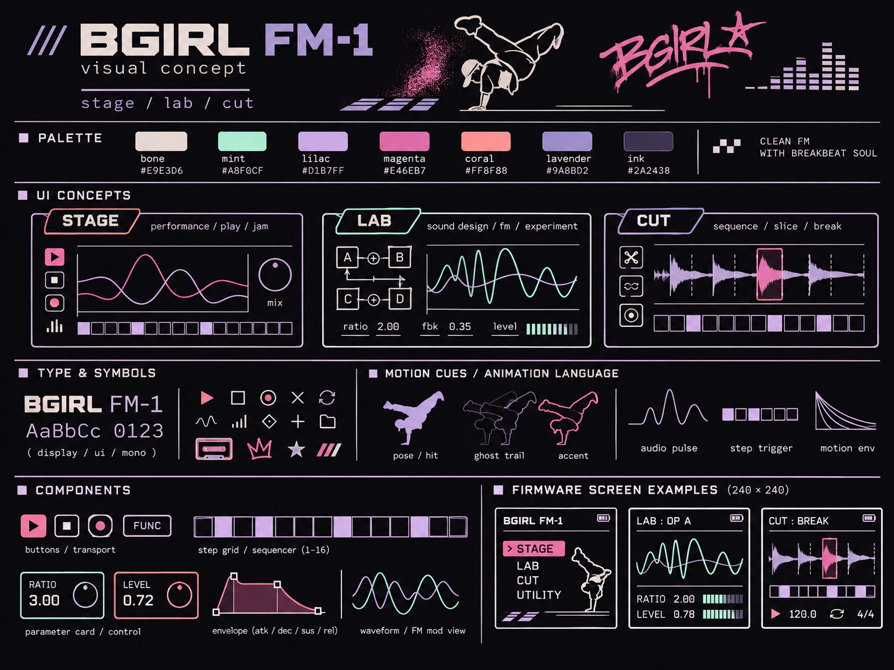

# BGIRL visual architecture — STAGE / LAB / CUT

Date: 2026-11-18. Status: **first-screen implementation in this same PR; Doug review pending**.
Tracking: [issue #35](https://github.com/track-forge/bgirl-fm1/issues/35).
Planning base: `c7116c5451bcfca9325ce71a71f7356ab1bd1b2c` (main).
Branch: `plan/stage-lab-cut`. [Implementation handoff](STAGE_LAB_CUT_HANDOFF.md).

## 1. Creative contract

An expensive laboratory synthesizer that ended up at an underground electro party.
Early-1980s experimental digital instruments, Fairlight-era precision, electro flyers,
and breakbeat culture—not generic synthwave, cyberpunk or a wall of graffiti.
The instrument is precise; the music is wild. Ordinary screens should be recognizable
as BGIRL without a logo. This is a composition and hierarchy redesign, not a recolor.



The board was supplied by Doug for this design handoff. It is a documentation-only
reference, not firmware artwork, an exact pixel specification, or an asset to slice
into production controls. Its generation/source details beyond that are not established;
no third-party endorsement or broader artwork license is asserted. Implement geometric
components in code; retain existing separately documented dancer/branding provenance.
The text below is authoritative where illustrative board details conflict with function.

### Accepted decisions

- STAGE, LAB and CUT are **visual contexts**, not new menus or navigation modes.
  Keep physical buttons, page families, four knobs and musical keyboard affordances.
- Use the reference's character; exercise judgment at the real **240×240** resolution.
- Preserve all four assignments, values, units and meaningful focus/disabled states.
- Reuse CREW HOME and FLOORWORK; no new dance asset generation or choreography engine.
- Borrow JIANT's typography configuration, not its identity, navigation or whole renderer.
- First deliver a handful of working firmware samples for review and iteration.
  Do not roll out across all pages before Doug approves that milestone.
- Preserve existing SLICES features. Defer investigating their non-intuitive usability.

## 2. Source audit and reuse boundary

Read AGENTS.md, README.md, BGIRL_BASELINE_PLAN.md, UPSTREAM.md, BUILD_STATUS.md,
BATTLE_CIRCUIT_UI_PLAN.md / BATTLE_CIRCUIT_VERIFICATION.md,
ARP_DANCE_IMPLEMENTATION_PLAN.md / ARP_DANCE_VERIFICATION.md,
CREW_ACTIVITY_CONTRACT.md / CREW_HOME_VERIFICATION.md and CREW_MOTION_REFINEMENT.md.
Use current source when historical documentation disagrees.

| Area | Current implementation | Treatment |
| --- | --- | --- |
| `ui.c`, `ui_draw.c` | Header 0–23; four 57×44 cards at y28; graph y76/h122; footer y202/h38. LARGE has tall cards and shorter graph on some pages | Decouple parameter binding from geometry; add page-family composition and shared regions |
| `params.c`, `ui_input.c` | Page families/scopes, engine-specific controls, knob actions and holds/layers | Reuse; no remapping or new navigation hierarchy |
| `ui_graph.c`, `ui_fm6op.c` | Existing envelopes, LFO, routing/operator graphics, sequencer and other graph models | Recompose truthful parameter-derived graphics, not arbitrary decorative waveforms |
| `gfx.c` | RGB565, 4-bit-alpha fonts/icons, cached palette tokens; `CV_MAX=240*124` uint16 pixels | Keep strip renderer and ABI; scratch canvas is 59,520 bytes, not a full framebuffer |
| `ui_crew.c` | One 96×96 selected-track dancer; six associations/five banks; ~67ms redraw cap with invalidation | Integrate composition; preserve timing/snapshot/crop contracts, no hidden choreography |
| `ui_slice.c` | Existing user-slot marker/POS/split/join; prepared vocal-bank path is different | Preserve supported operations and source restrictions, restyle later |
| `ui_menu.c`, `ui_layer.c`, `ui_name.c`, `ui_events.c`, `ui_tools.c` | Separate lists/overlays/name/events/action renderers | Audit as explicit later families, not covered by changing only graph pages |
| `felucca/web/emu/index.html` | Browser instrument shell and real input targets | Secondary alignment pass; not a substitute HTML interface |

Six full tracks, 64 steps each, eight shared voices remain unchanged. Retain latest
SH-ISH collection labels, sound banks and demo changes from main. CREW has already
landed in the planning base; do not cherry-pick obsolete branches or redo it.

Create a screen/state inventory before coding: family, engine-specific variants,
existing parameters, current region geometry, context, normal/LARGE treatment,
required data, overlays and validation fixture. A context mapping is not a new enum
persisted into projects. Roughly 12k lines of existing ui*.c are not permission to
rewrite them wholesale; extract only the seams needed by the prototype.

## 3. Practical design system

### Color and geometry

Start from board swatches, validate after RGB565 quantization:

| Role | Starting color | Use |
| --- | --- | --- |
| Canvas | Near-black, provisionally `#090B0C` | Main negative space; board's `#2A2438` ink swatch is a secondary dark surface candidate, not mandatory canvas |
| Bone | `#E9E3D6` | Primary readable text |
| Mint | `#A8F0CF` | Signals and synthesis graphics |
| Lilac / lavender | `#D1B7FF` / `#9A8BD2` | Structure, sequencing, secondary instrumentation |
| Magenta / coral | `#E46EB7` / `#FF8F88` | Focus/performance accents; warnings/recording remain semantically distinct |

Lines represent signals, squares represent events, circles represent controls.
Expressive marks supply personality sparingly. Do not draw circular knobs for every
value if they waste useful space. Use thin rules, deliberate negative space and a
small consistent spacing scale (start 2/4/8px; adapt from native screenshots).
No noisy texture, animated scanlines, glows or unnecessary full-screen motion.

Define reusable parameter readouts, K1–K4 markers, section labels, signal paths,
operator nodes, envelope vertices, step cells, focus frames and transport/status marks.
Keep physical K1–K4 order explicit and stable; a compact readout rail is a starting
hypothesis, not a mandatory replacement layout for every page. Selected parameter
gets immediate feedback, including text/shape—not hue alone. Values must remain
readable during rapid edits; decoration yields first under space pressure.

Separate visual layout identity from palette choice. New composition must not exist
only behind `ux.circuit`. Keep stored palette IDs/custom bytes and HOME settings,
FLAT/LINE intent and ANIM preferences. If adding a palette, append using existing
compatibility conventions; do not silently overwrite valid saved colors. Establish
token fallbacks for GREY/MONO/light/custom palettes. Unknown settings retain existing
safe fallbacks. Do not undertake a settings-schema redesign.

### Typography: verified JIANT reference

Pinned JIANT revision: `b5be0d4fa493ccf4c15e3a5255afe134b6d99107`.

- [Font generator](https://github.com/juanjiant-bit/JIANT/blob/b5be0d4fa493ccf4c15e3a5255afe134b6d99107/tools/gen_aa_font.py)
- [Build invocation](https://github.com/juanjiant-bit/JIANT/blob/b5be0d4fa493ccf4c15e3a5255afe134b6d99107/tools/build.py)
- [Font sources/notices](https://github.com/juanjiant-bit/JIANT/tree/b5be0d4fa493ccf4c15e3a5255afe134b6d99107/assets/fonts)

| Role | Starting face | Reference configuration |
| --- | --- | --- |
| Labels/navigation/parameter names | Chakra Petch Medium 12px | S, tracking -0.055em |
| Numeric values/primary readouts | Inter Tight SemiBold 15px | M, weight600, zero tracking |
| Prominent headings | Michroma Regular 18px | L in JIANT, zero tracking, sparse character set |

All three are identified as SIL OFL1.1 in the source; bundle/verify each font's actual
notice, preserve copyright/reserved names, record source revision and file hashes.
Retain source-code licenses/notices for any adapted generator logic. Do not import
unrelated JIANT artwork, engine changes, pins or release tooling.

Extend **our** `felucca/tools/gen_aa_font.py` with a BGIRL preset and wire it through
our `felucca/tools/build.py` asset generation. No runtime TTF renderer, network font
fetch or separate browser-only font substitution for the LCD.

Important compatibility details from inspection:

- JIANT uses two horizontal phases for S/M/L; ours uses four for S/M and two for L.
  Start with our supported format/phases; compare two-phase output only if useful.
  Do not assume JIANT's stated savings apply to this build.
- Both use 4-bit alpha and Huffman coding for M/L, with S kept uncompressed.
  JIANT's newer split/packed glyph metadata and helper API differ from our `aag_t`.
  Borrow the face configuration; do not copy its generator wholesale.
- The sparse L set omits characters including Z and lowercase. Establish real
  heading/value coverage and documented M fallback; test all actual UI strings.
- Our current LARGE readouts use 28px Inter Tight. **Do not globally replace AF_L
  with 18px Michroma and call it accessible LARGE.** Separate heading/display roles
  if needed, retain or add a truly large numeric face, measure the asset cost and
  exercise both layouts. Adjust hardcoded baselines/cap-height assumptions.
- Audit unit suffixes, negative signs, decimals, ratio/frequency modes, long names,
  custom names, ellipses and special glyphs. Labels must not become clipped through
  aggressive tracking. Font changes can affect unmigrated pages immediately: test them.

## 4. First working milestone

### HOME / STAGE

Make the dancer and musical performance primary, not a graph inside old cards.
Use existing selected-track CREW, transport/BPM, selected track/sound and compact
four-knob readouts. Optional six-track activity/status marks must use safe existing
published data, not mutable voice reads or six background animation loops.
Activity is not an audio meter. Avoid overloading the display with every status.
Preserve SCOPE/TRACKS/LEVELS views, HOME→MIXER→CLOCK behavior, banked GLO controls,
CREW one-time default marker, 22-step ping-pong/crops and independent ARP DANCE.

### Synth / LAB

Use an actual DIGITAL/FM operator page with real algorithm/operator selection and
parameter-derived routing as the visual center. Keep its actual four bindings and
units; do not use a fictional four-operator chart for a six-operator engine. Show
selected operator clearly, distinguish carrier/modulator roles where data supports
it. No new synthesis or analysis. ENV is an early second-page check that the same
readouts/spacing/geometry can serve an envelope without a one-off renderer.

### Sequencer / CUT

Use existing drum STEP grid. Strong event cells and beat groups; retain lane
selection, step editing, accent, bank/page, pattern length and mute indication.
Separate edit cursor, playhead and sounding/occupied cells so overlaps remain
readable without hue. Cover 64-step patterns through existing bank behavior; do not
change sequencer data or promise a sample cutter. Later piano-roll and sample views
inherit the vocabulary, not necessarily the same grid layout.

### First-milestone completion gate

All three are real firmware-rendered, interactive 240×240 screens in a working
browser build. Native before/after comparisons and short interaction clips show
normal/LARGE and stopped/playing/editing states. ENV may be a fourth sample.
Deliver for Doug's judgment; **stop here before the full UI rollout**. Ordinary
screens must look distinct even with branding hidden. Technical green is not
visual/playability approval. Incorporate review before expanding the design.

## 5. Implementation sequence and reviewable commits

1. **Baseline/inventory:** verify fresh main, initialize pinned submodules, build and
   run baseline suites; save exact revision, native images and redraw measurements.
   Record current regressions rather than silently accepting or rebaselining them.
2. **Typography/minimal layout seam:** add sourced fonts and preset, preserve ABI;
   separate presentation regions/readout bindings enough for three page families.
   Prototype static native layouts, measure sizes and check global typography fallout.
3. **Three screen implementations:** small commits for STAGE, LAB and CUT, sharing
   primitives. Preserve all input/state ownership. Add ENV portability check.
4. **Evidence/first review:** regression/visual matrix, browser build, source/size/cost
   report, reproducible demo recipe, update same PR. Wait for Doug's design review.
5. **After approval, later scoped work:** remaining synthesis/FX/vocoder, piano-roll/
   samples/automation/song, mixer, menus/layers/naming/dialogs/utilities and browser
   shell alignment. Agree subsequent PR slices at review; do not implement all now.

A small shared foundation belongs before/alongside prototypes, not a speculative
framework built before seeing pixels. Layout descriptors or bounded family renderers
are both acceptable; avoid duplicating the entire draw loop/input state per page.
Keep fallback rendering usable for unmigrated screens. Shared font changes may affect
all pages, but broad composition rollout remains gated.

## 6. Rendering, truthfulness and behavior contracts

- Keep scratch canvas capacity bounded. Regions taller than124 full-width rows
  require strip/tile rendering; `cv_begin` currently clips oversized requests.
  Do not silently allocate a second/full framebuffer or assume height expansion works.
- Invalidate changed regions and clear old geometry on page/track/overlay transitions.
  Keep caching signatures correct for palette, style, LARGE, values and activity.
- No animation catch-up backlog; no hidden/unchanged CREW blits. Retain existing
  rate cap and ANIM/idle behavior; any intentional cost change needs measurement.
- No allocation, logging, I/O, blocking or graphics work in audio callbacks; no
  new unsynchronized mutable voice reads. Reuse existing scope/activity snapshots.
- Label/data-contract each visualization: live scope, parameter-derived diagram,
  accepted-note activity or sequencer event. No fake analyzer/meters or fabricated
  sample waveform. Cache actual waveform summaries outside the audio path if needed.
- Preserve knobs/holds, layers, undo, locks, MIDI learn, transport/clock, note-off,
  eight-voice admission, presets/projects/autosave and B6S1/PER5/editor protocols.
- No engine/BSP pin changes, new DSP, sound-bank/demo edits, new sample-editor or
  time-stretching features. Existing slices may be restyled; usability redesign later.
- Crowned animation [#21](https://github.com/track-forge/bgirl-fm1/issues/21) and
  tempo-fit [#12](https://github.com/track-forge/bgirl-fm1/issues/12) remain separate.
- No device build/flash, merge, release, workflow activation or manual deployment.
  A local browser review build is required; do not repoint shared preview services.

## 7. Validation and deliverables

Run before and after implementation (activate README's existing Emscripten toolchain):

```sh
./build.sh --web
./tests/run_tests.sh
git diff --check
```

Use the existing native `felucca/tests/ui_render.c` + `ui_render.py` path and
Battle Circuit verification recipe for real 240×240 screenshots/layout lint.
Extend actual firmware fixtures for new composition; deliberately update layout
assumptions, not blanket-disable clipping/contrast/alignment tests. Preserve audio
goldens; a visual-only change should not alter rendered audio. Run relevant font
spacing/coverage checks and measure generated table sizes/reproducibility.

Run actual Chromium acceptance with `BGIRL_URL` pointing at the local build, using
existing tests/browser-smoke.cjs, battle-browser.cjs, crew-browser.cjs,
dance-browser.cjs, six-browser.cjs and affected vocoder/vocal/clarity/mega/SH-style
suites. Inspect current scripts and supported environment options, not guessed
commands; record exact commands/revisions/results. Add focused new design coverage.

| Matrix | Required observations |
| --- | --- |
| Native UI | Before/after HOME/FM/STEP; ENV cross-check; 1× and enlarged views |
| Readability | Normal/LARGE; longest labels/units, signs, enums, unavailable controls, missing samples |
| States | Cursor/playhead overlap, muted/solo/armed, active/stopped, rapid edits, external clock and track switches |
| Compatibility | Saved/custom/mono/light palettes, FLAT/LINE, ANIM preferences, four HOME views and restore |
| Overlays | GLO/holds, help/toasts, count-in, naming, destructive confirmations/cancel and PROJECT FULL; no stale pixels |
| Browser | Actual audio after user gesture; keys/knobs, STOP/release, save/reload, responsive shell/focus, no page errors |
| Music | Existing audio goldens and native/WASM comparisons, MIDI/clock, persistence and CREW/ARP invariants |
| Cost | Per-font/table and aggregate asset bytes, native/WASM section/size deltas, scratch/stack changes, blit counts/pixels/rate |

Record redraw costs at idle, steady play, rapid knob turns, track/page switches and
maximum existing dense musical fixture; compare against the same baseline recipe.
Use existing GFX hooks to count blits/pixels. Don't invent device FPS/CPU budgets:
host timing and browser animation are not LCD DMA or target deadline measurements.
Hardware acceptance later includes actual LCD legibility, tearing/transfer timing,
flash/RAM/linker fit and worst-case audio deadline/xrun behavior. Mark **not tested**.

Deliver `docs/STAGE_LAB_CUT_VERIFICATION.md` with evidence paths, exact tested head,
commands/results, native screenshots, font licenses/hashes and unresolved findings.
Supply a local browser launch recipe and brief interaction walkthrough. Update README
status only to what was implemented. Link the tracking issue as **Refs #35**, not
Closes: the three-screen PR is a milestone, not completion of the full overhaul.

## 8. Planning verification

This initial PR contains documentation and the supplied reference image only.
Source audit and pinned typography inspection completed; no fonts/runtime imported,
no new screenshots claimed, no build/audio/browser/device tests run for planning.
The supplied typography paste ends mid-item2; only its explicit font stack and
pipeline goals are treated as requirements. This plan supplies the bounded execution
contract rather than inventing missing text.
