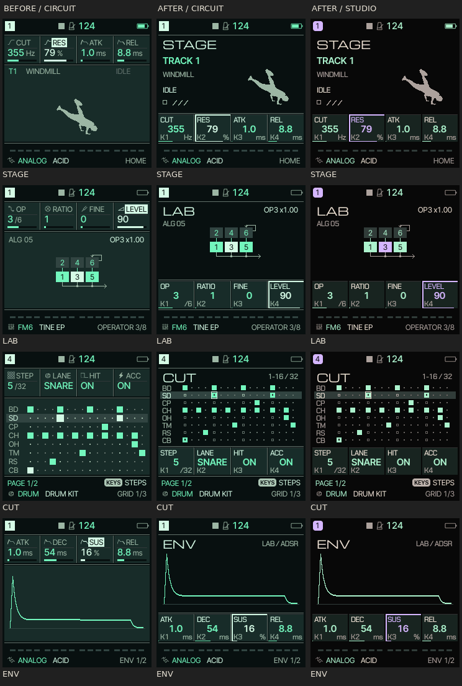
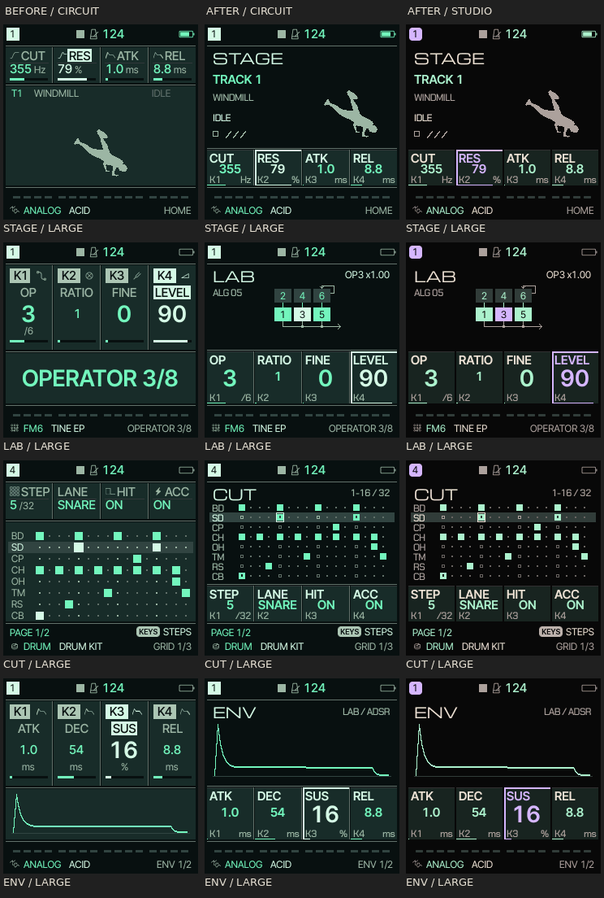
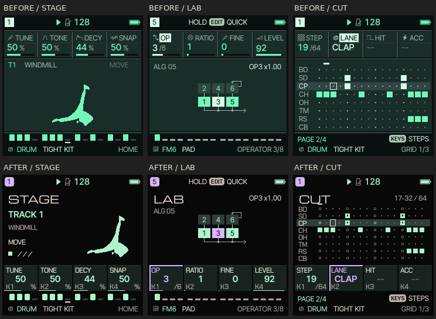
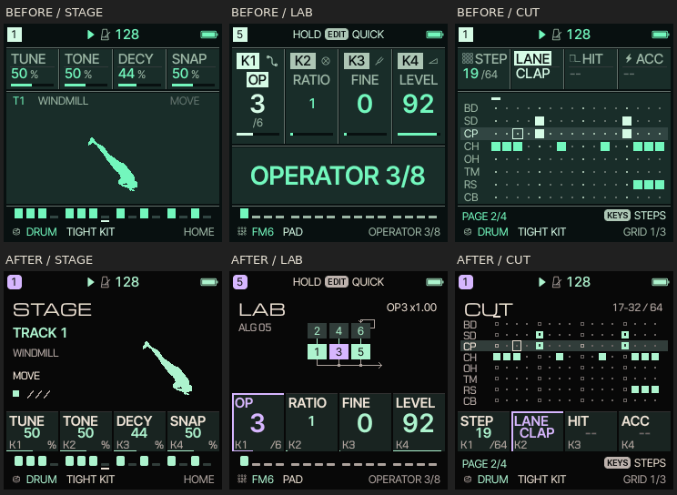

# STAGE / LAB / CUT — first-screen review

Implementation in progress on the existing draft PR36. Refs #35.

## Baseline and screen inventory

Baseline runtime/main: `c7116c5451bcfca9325ce71a71f7356ab1bd1b2c`;
planning head: `7d2a0fe73f9bcc2e28b2eae69b66c3b1c60fb107`.
Remote main unchanged at implementation start. Pinned submodules initialized;
engine/BSP revisions unchanged. Browser/host only, no device build.

| Family | Existing bindings / visual data | First milestone |
| --- | --- | --- |
| HOME / CREW | Engine's four knobs; selected-track atomic activity and existing 96px masks | STAGE, performance-first, readouts below |
| HOME SCOPE/TRACKS/LEVELS | Scope snapshot / track status / banked levels | Existing composition retained |
| FM6 OPERATOR / OPERATOR2 | OP/coarse/fine/level; OP/mode/detune/velocity; actual six-op patch routing | LAB, routing-first, readouts below |
| ENV | ATK/DEC/SUS/REL, parameter-derived envelope | Shared LAB-layout cross-check |
| Drum STEP | Step cursor/lane editing and events, accents, mutes, 16-step banks of64 | CUT, event-first, readouts below |
| Melodic STEP/DETAIL, OP ENV and remaining sound/FX pages | Existing parameter bindings/graphs | Fallback unchanged; shared typography audited |
| MIXER/CLOCK, lists, layer maps, naming, dialogs, count-in | Existing owners/overlays | Existing composition; transition checks |

Original geometry: header0–23, cards28–71 (LARGE tall28–131), graph76–197
(LARGE strip136–197), footer202–239. Layout identity is not persisted.

Baseline commands (logs under ignored `local/stage-lab-cut/`):

```sh
source /home/dev/.local/share/bgirl-emsdk/emsdk_env.sh
./build.sh --web
./tests/run_tests.sh
# Native comprehensive renderer: same HAL includes as host tests
cc -O1 -w -DFELUCCA_VERSION='"1.8.1"' \
 -Ifelucca/firmware/hal -Ifelucca/firmware/bsp/chip \
 -Ifelucca/firmware/bsp/boards/fm1 -Ifelucca/build/gen \
 -Ifelucca/firmware/src -Ifelucca/tests \
 -o local/stage-lab-cut/ui-baseline felucca/tests/ui_render.c -lm
local/stage-lab-cut/ui-baseline local/stage-lab-cut/before
python3 felucca/tests/ui_render.py local/stage-lab-cut/before
```

Baseline native comprehensive renderer **already fails**: 4044 layout findings,
zero ink/neutrality/alignment failures. Preserve this finding ledger for comparison;
do not treat a newly green subset as a comprehensive pass. Focused four-screen
matrix baseline: zero findings/ink/neutrality/alignment failures. Native WASM baseline
956577 bytes. Canvas59520 bytes. Audio baseline111 goldens unchanged (full suite
receipt to follow). Focused renderer reuses upstream hooks and scene setup through
`BGIRL_RENDER_LIBRARY`; no copied firmware renderer.

## Delivered composition / review evidence

Runtime source: `80aa1e411a96dd159281d19f8f8aee4c862728f6` (subsequent changes
only tests, documentation and review artifacts). Same draft PR36; no merge.

- **STAGE:** dancer owns the right-hand stage; track/move/accepted-activity text
  owns the left. Same96px masks, phases, one selected dancer and67ms rate cap.
  The small square is admitted-note activity, **not a level meter**.
- **LAB:** six real operators and patch routing precede four real operator
  readouts. Carrier/modulator fill and selected operator remain distinct. Actual
  patch algorithm/frequency are shown. OPERATOR2 shares the composition.
- **CUT:** existing drum events, lane selection and16-step banks. Event=filled
  square; accent=inset hole; cursor=outside frame; playhead=top dash. Ratchets,
  lock/detail marks, lane mute slash and explicit bank range remain visible.
- **ENV:** the same readout rail serves the real parameter-derived envelope.
- Normal graph28–149 / readouts154–197; LARGE LAB/ENV graph28–129 /
  readouts134–197. Header/footer ownership and K1–K4 order remain unchanged.
  CREW and drum LARGE retain their full graph and bigger labels, as before;
  LAB/ENV keep genuine28px values (whole-range M/S fallback where required).
- New layout is independent of palette and FLAT/LINE. STUDIO appends ID11,
  stored ID75; existing IDs, custom bytes and explicit saved choices are not
  overwritten. Only fresh settings choose STUDIO. No new persisted context enum.

### Native240×240 images

Rows: STAGE, LAB, CUT, ENV. Columns: old CIRCUIT, new CIRCUIT, new STUDIO.
The same-palette middle column separates composition from recoloring.
Each constituent native PNG is alongside the sheets; click/open for enlarged view.





### Real browser interaction clips

Before on top; after below. Actual firmware canvas, not an HTML mockup. STAGE is
playing; LAB changes operators with the physical K1 control; CUT shows playback,
bank/lane/cursor editing. GIFs are sampled/re-timed for inspection, **not tempo or
LCD transfer measurements**. Full individual frames remain local under
`local/stage-lab-cut/browser-{before,after}/`.





## Verification results

Final root web build and `./tests/run_tests.sh`: **PASS**, browser/host only.
111 audio goldens unchanged; zero health/voice/routing failures. Native/WASM
88200 heavy-song,176400 clarity and661500 Mega frames bit-identical. Existing
input/MIDI/clock, six-track storage/editor, locks/undo, project capacity, autosave,
vocoder/vocal/signature, disabled-vocoder and CREW/ARP preservation checks pass.
No audio golden, engine/BSP pin, demo or sound bank was changed.

`./tests/run_stage_tests.sh`: **PASS**.384 four-screen/palette/style/size/transport
compositions; every actual FM algorithm×six operator selections in normal/LARGE;
all64 cursor/playhead overlaps×eight selected/muted lanes in both sizes; all
engines' real CREW HOME knob ranges in normal/LARGE. Zero clipping/overlap,
invisible ink, GREY/MONO neutrality or alignment findings in this focused matrix.
The full root runner includes this test. [Focused receipt](img/stage-lab-cut/evidence/focused-report.txt).
Existing CREW tests retain exact mask/erasure, hidden/idle and redraw-cap assertions
at the newly relocated rectangle. LARGE card geometry tests are updated to actual
regions; graph isolation and one-column focus/edit assertions remain enforced.

Comprehensive inherited renderer is **NOT green**: baseline4044 →4388 findings.
The extra344 are inherited fallback-page findings repeated in STUDIO. Exact
normalized finding comparison over the original11 palettes has **zero additions
and zero removals**. Zero invisible-ink/neutrality/alignment failures;1699 LARGE
knob ranges still retain one value size. Existing findings include PROJECT
ellipsis and SONG bands/overlap. They were neither fixed out of scope nor hidden.
[Before ledger](img/stage-lab-cut/evidence/layout-before.txt) ·
[after ledger](img/stage-lab-cut/evidence/layout-after.txt) ·
[delta receipt](img/stage-lab-cut/evidence/lint-delta.json).
`UI_LINT_LIMIT=12000` increases diagnostic capacity only, not acceptance thresholds.

Actual headless Chromium suites: browser-smoke, battle, crew, dance, six, vocoder,
vocal, mega, SH-style, clarity, signature, splash and demo **PASS**.
[Suite receipt](img/stage-lab-cut/evidence/browser-suites.txt).
`tests/stage-browser.cjs` additionally exercises normal/LARGE physical navigation,
FM K1–K4 edits, drum bank/cursor/lane edits, real user-gesture AudioWorklet audio,
STOP and390px mobile layout: PASS, no page errors; measured peak about0.0893.
Its LCD-label wait synchronizes to device-rendered state rather than assuming
wall-clock sleep equals simulated device time under concurrent test load.
[Result](img/stage-lab-cut/evidence/browser-results.json).

Baseline uses the same existing nine directly affected browser suites, plus the
focused four-screen browser recipe; all PASS. The final broader13-suite matrix
above also passed. Clarity's required historical listening manifest was copied
unchanged from the retained c7116c5 local artifact; no audio/gallery was rendered
or relabeled. Raw build/test/browser logs are ignored locally in
`local/stage-lab-cut/`. Review artifacts are committed here.

Automated regression coverage includes external clock, rapid edits, track changes,
GLO/layers, dialogs/cancel/count-in, naming, save refusal/PROJECT FULL, palette
roundtrips, all four HOME choices, preferences and save/reload. This is **not** a
claim that Doug has visually/playability-approved every overlay or compatibility
combination. Native manual inspection sampled all four screens, LARGE, MONO,
PAPER, LINE and overlapping drum marks; full human review remains open.

## Typography provenance / cost

Unmodified source files/notices are in `felucca/assets/fonts/`; see
[BGIRL-SOURCES](../felucca/assets/fonts/BGIRL-SOURCES.md), credits/licensing and
[SHA256 receipt](img/stage-lab-cut/evidence/font-hashes.txt).
The JIANT configuration reference is pinned to
`b5be0d4fa493ccf4c15e3a5255afe134b6d99107`.

The `bgirl` generator preset **appends C/V/H faces** for this milestone instead of
swapping typography on unreviewed pages. Existing S/M/L tables and metrics are
byte-identical;28px L stays intact. C=Chakra Medium12/−0.055em, V=Inter Tight60015,
H=Michroma18 with complete A–Z, digits and specified heading punctuation. C/V have
printable ASCII and existing extras. No newer JIANT glyph ABI is imported.

| Face | Generated data+metadata+kerning |
| --- | ---: |
| Existing S/M/L |42792 B, unchanged|
| C / Chakra |16310 B|
| V / Inter Tight600 |20133 B|
| H / Michroma |5048 B|
| Total |84283 B (+41491 B)|

Generated header repeat is byte-identical. All source fonts contain printable
ASCII. All six faces pass the existing supersampled spacing test, extended to the
new roles and their actual tracking (no relaxed limits): C max gap error0.196px,
V0.236px, H0.425px. [Font proof](img/stage-lab-cut/evidence/font-proof.json) ·
[table costs](img/stage-lab-cut/evidence/font-cost.log) ·
[spacing receipt](img/stage-lab-cut/evidence/font-spacing.log).

## Measured resources / redraws

Same GCC15/O1 `tests/bgirl_test.c` linked build, same pins:

| Resource | Baseline | New | Delta |
| --- | ---: | ---: | ---: |
| Native text+rodata |887509 B|933677 B|+46168 B|
| Initialized data |1596 B|1596 B|0|
| BSS |1654848 B|1654848 B|0|
| Scratch canvas |59520 B|59520 B|0|
| WASM |956577 B|1010908 B|+54331 B|
| WASM initial memory |33554432 B|33554432 B|0|
| Track / project wire |1856 /3840 B|same|0|

No new framebuffer, mutable UI fields, dance masks or audio-path work. GCC host
`-fstack-usage` bounded per-function frames: draw_column288→272 B,
draw_graph416→416 B, draw_columns944→944 B, ui_draw240→240 B. Inlining is included;
this is **not** whole-call-chain or target worst-case stack proof.
[Stack receipt](img/stage-lab-cut/evidence/stack-proof.json).

Deterministic actual-emulator recipe in `tests/stage-cost.c`: each screen, normal
and LARGE, idle/play44800 stereo frames (~1.016s);100 real knob edits×128 frames;
100 track switches×896 frames; dense six-track fixture44800 frames. GFX hooks count
scratch blits/pixels (not background fill commands, audio CPU or physical DMA).
Before is compiled against frozen c7116c5 runtime and baseline generated assets.
After uses this implementation. The diagnostic asserts nonzero hooked redraws.

| Selected scenario | Baseline blits / pixels | New blits / pixels |
| --- | ---: | ---: |
| STAGE normal idle |0 /0|0 /0|
| STAGE normal play |22 /482880|22 /482880|
| STAGE dense play |20 /400800|20 /400800|
| LAB LARGE100 knob turns |16 /94848|36 /547968|
| ENV LARGE100 knob turns |32 /332928|32 /450048|

LARGE LAB intentionally pays453120 more transferred pixels in this100-edit burst:
actual routing stays visible and reactive instead of a static title strip.
Unchanged normal stage/graph sizes retain their existing payload budgets. CREW
still caps animation at15 paints/s; one changed240×122 graph costs58560 bytes,
up to878400 B/s at that cap, before other changed UI regions. Some measured
"idle" totals include inherited header/footer changes, not hidden dancer work.
[All before scenarios](img/stage-lab-cut/evidence/cost-before.csv) ·
[all after scenarios](img/stage-lab-cut/evidence/cost-after.csv).

WASM SHA256 baseline:
`e8b36329d052a0f8f858f57a710e06c5e181cd7285cfe1ff004c8a1c0244f3f4`.
New:
`f3bde4be3b8fca457098531d37545ff15a5012ce4f950b8200222260b7df8686`.

## Reproduce / play locally

```sh
source /home/dev/.local/share/bgirl-emsdk/emsdk_env.sh
./build.sh --web
./tests/run_tests.sh
./tests/run_stage_tests.sh
(cd felucca && python3 tests/text_spacing_test.py build/gen/ui_fonts.h)
git diff --check
python3 -m http.server 8807 --bind 127.0.0.1 --directory felucca/build/emu
```

Open <http://127.0.0.1:8807>, **Switch on**. On a fresh origin HOME is CREW;
existing origins: HOME hold→DISPLAY→HOME→CREW. Saved colors remain saved; select
STUDIO explicitly through COLOR if desired. PLAY and ALGORITHM exercise STAGE.
Fresh navigation: ALGORITHM four detents to T5/FM6→EDIT slowly three times to
OPERATOR/LAB. K1 picks one of six operators, K2–K4 edit actual patch fields.
HOME→ALGORITHM twice to T1→SEQ/STEP for CUT; K1 traverses banks, K2 chooses lanes,
K3/K4 retain HIT/ACC. ENV opens the shared envelope layout. HOME hold→DISPLAY→
LARGE tests the28px readouts. EDIT remembers its last page; cycle to OPERATOR
instead of assuming the first visit's three taps on later visits.

Browser automation (use the installed paths or your own):

```sh
export BGIRL_URL=http://127.0.0.1:8807
export PLAYWRIGHT_MODULE=/home/dev/.npm-global/lib/node_modules/openclaw/node_modules/playwright-core
export CHROMIUM_PATH=/home/dev/.cache/ms-playwright/chromium-1228/chrome-linux64/chrome
node tests/stage-browser.cjs
node tests/crew-browser.cjs
```

The focused browser run uses its own disposable context. Its second size pass
clears only that test context to repeat the same first-visit physical navigation;
preference/save restoration is independently exercised by CREW and existing suites.

## Stop / remaining review gates

**Stop here for Doug's visual/playability review.** Main issue35 stays open.
Full-page rollout, secondary browser-shell alignment and optional sampler/usability
work remain later slices. All existing compositions outside these samples remain.

Not tested: physical LCD legibility, tearing/DMA/transfer latency, target linker
fit/RAM/stack, audio deadlines/xruns and physical MIDI/USB. No device build/flash,
DSP rewrite, sample editor, crowned animation, merge/release, shared-preview
repointing, workflow activation or public/manual deployment was performed.
