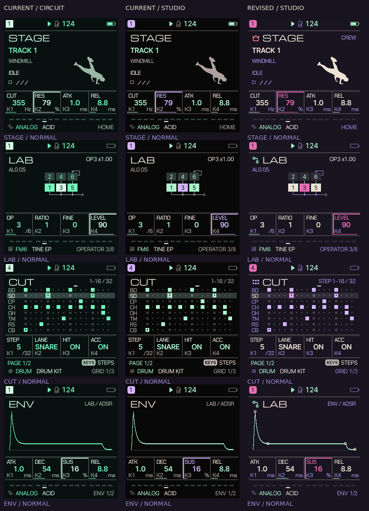
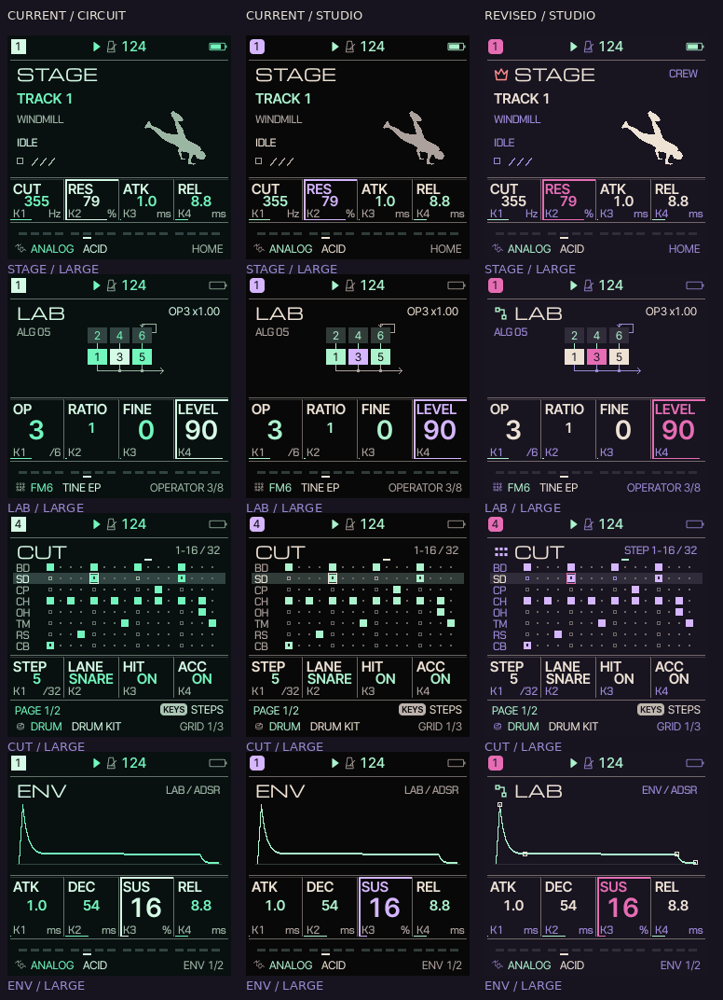
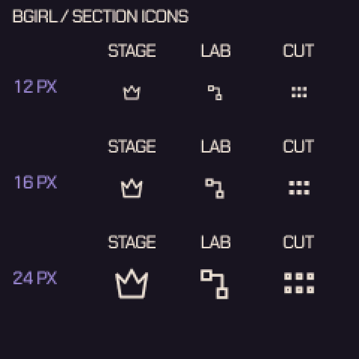

# STUDIO identity — iteration 2 review

Refines the first-screen redesign on PR [36](https://github.com/track-forge/bgirl-fm1/pull/36),
not a new navigation system. Baseline: `77a27562a7d1f60b54e6eba5a9584cf3e84b77f4`.
Runtime implementation: `53e63d0` (subsequent commits contain verification/tests/docs).
**Doug's visual/playability review remains pending. No merge or deployment.**

## Native display comparisons

Each tile is the actual 240×240 RGB565 firmware framebuffer, not an HTML mockup.
Columns: iteration-one AFTER/CIRCUIT, iteration-one AFTER/STUDIO, revised STUDIO.
The same fixture state and LINE style are used in each column; rows are STAGE,
LAB, CUT, ENV. Playback is enabled, but the deterministic STAGE capture is between
onsets, not a continuous-performance assertion.





[Native STAGE](img/studio-v2/stage-normal.png) · [LAB](img/studio-v2/lab-normal.png) ·
[CUT](img/studio-v2/cut-normal.png) · [ENV](img/studio-v2/env-normal.png).

## One identity, semantic color

| Role | Color | Use |
|---|---|---|
| Ink | Warm near-black | Background, no pure-black competing identity |
| Bone | Warm neutral | Primary text, values, dancer, carrier operators, envelope vertices |
| Mint | Signal | Technical traces, routing, activity, playing sequencer column |
| Lilac | Rhythm | Occupied drum events and rhythmic gauges |
| Lavender | Supporting structure | Labels, units, page details and supporting lines |
| Magenta | Focus | Active parameter, selected operator, drum edit cursor |
| Coral | Performance / record | Static crown, actual onset dancer accent, recording/warnings |
| Surface | Dark raised region | Subtle panel separation |

An occupied step is lilac, the playing column is mint, and the edit cursor has a
magenta frame; the cursor remains visible when it coincides with playback. Disabled
values remain DIM, not lavender supporting text. Primary readouts are bone; focus
is not the same as recording. Coral's section marker is static, while the dancer's
coral accent is driven by the existing onset event.

The supplied targets are quantized for RGB565. Ink is authored as `(24,20,32)` and
Surface as `(40,32,48)` to land on the intended native dark values. STUDIO's raised
blend is 6% rather than 12% to keep magenta focus legible. Existing contrast limits
were not relaxed; [quantized contrast report](img/studio-v2/palette-contrast.txt)
passes all twelve built-in palettes, including additional STUDIO semantic checks.
Bone/background is 14.2:1; magenta/background 6.2:1; magenta/surface 5.4:1.

STUDIO was already fresh-session default and remains so. Palette IDs, preference
wire format and the five-color custom palette schema are unchanged. Extra rhythm,
support, play and stage roles are derived in RAM, never persisted. Fixed STUDIO
colors apply only to the built-in STUDIO choice: restored/custom palettes retain
their stored colors, with derived roles falling back to their own theme/text/mid.
CIRCUIT remains selectable. No second visual redesign was maintained.

## Three original section icons



[Native 240×240 icon sheet](img/studio-v2/icons-native.png) ·
[Section header close-ups, 2× nearest-neighbor](img/studio-v2/headers-2x.png) ·
[Original size-specific SVG sources](../felucca/assets/bgirl-icons/README.md).

STAGE uses Doug's requested simple three-point crown. LAB connects two operator
boxes; CUT uses six rhythmic cells. Each has independently authored 12/16/24px
geometry with consistent optical weight and padding. Monochrome source artwork
is recolored with theme tokens. These are original geometric drawings, not a
tracing of an artist's artwork. The crown is only an icon, not a new animation.

The existing `gen_aa_icons.py` path now accepts these restricted build-time SVGs,
then uses the existing alpha4/Huffman streams and `cv_icon_in` firmware decoder.
No runtime SVG or parallel renderer. Existing IDs remain stable, and a decoded-alpha
hash check proves all 150 inherited icon cells are unchanged. Existing functional
icons, FLOORWORK masks, pose selection and event timing remain intact.

Headers combine the 16px section icon with the section title. LAB retains OP/ratio
and ALG context; ENV says `ENV / ADSR`; CUT says `STEP` plus bank/length. The existing
actual page title/footer and navigation remain available. Four physical knob
bindings, values, fonts, LARGE sizes and page geometry remain unchanged.

## Validation

| Check | Result |
|---|---|
| Web build | PASS |
| Root host/UI/persistence/input/audio suite | PASS, exit 0 |
| Audio regression | 111 golden renders unchanged, zero health/routing/CPU-budget failures |
| Native/WASM parity | Heavy-song, clarity, Mega and SH-STYLE checks PASS |
| CREW | Exact masks/erasure/rate cap and 512,000-frame audio/RNG preservation PASS |
| Focused native composition/range matrix | PASS: zero findings/ink/neutrality/alignment/lost measurements |
| Palette contrast and custom/saved behavior | PASS |
| Icons | PASS: 150 inherited alpha cells unchanged, nine new SVG/decoder matches |
| Focused physical-navigation Chromium test | PASS: normal/LARGE, four pages, knob edits, nonzero audio, no errors |
| Existing Chromium suites | 13/13 PASS |
| Comprehensive inherited layout lint | FAIL, unchanged 4388 findings; zero new/removed |
| Physical hardware | Not tested |

[Full host log](img/studio-v2/host-tests.txt) · [Browser suite exits](img/studio-v2/browser-suites.txt) ·
[Focused browser results](img/studio-v2/browser-results.json) · [Native receipt](img/studio-v2/focused-native.txt) ·
[Resource receipt](img/studio-v2/resources.json).

Existing Chromium suites are browser-smoke, battle, CREW, dance, six-track,
vocoder, vocal, Mega, SH-STYLE, clarity, signature, splash and demo. Focused stage
browser ran again after the ENV focus fix; early suites were also [repeated on the final runtime](img/studio-v2/browser-final-reruns.txt). GitHub exact-head CI is separate from these local results and is
reported on the PR; no CI pass is inferred from local runs.

See the receipts below for final results. The focused firmware matrix covers all
12 palettes, FLAT/LINE, normal/LARGE and stopped/playing. Range/topology/64-step
cursor-playhead sweeps additionally run in both CIRCUIT and STUDIO, including all
32 FM algorithms × six selected operators, all eight drum lanes, muted lanes,
ratchets/accents, bank boundaries and actual engine HOME parameter ranges. Existing
UI tests cover long names, signed values, disabled controls, saved settings and
custom import/export. A caught ENV focus redraw regression was fixed by keeping
vertices bone; moving readout focus does not alter the graph.

The broad inherited renderer is **not green**: 4388 layout findings, exactly the
same finding multiset as iteration one (zero added/removed). This is not a new
baseline and not a claim that all pages fit. Ink, neutrality and alignment checks
remain separately reported. [Before ledger](img/studio-v2/layout-before.txt) ·
[After ledger](img/studio-v2/layout-after.txt) · [Exact delta](img/studio-v2/lint-delta.json).

## Local review and scope

The local browser build is at <http://127.0.0.1:8807>. It runs the same firmware
renderer. For navigation, physical controls and local rebuild instructions use
[the existing playability recipe](STAGE_LAB_CUT_VERIFICATION.md#reproduce--play-locally).
Fresh settings use STUDIO; an existing origin intentionally keeps saved settings.
Select COLOR → STUDIO to compare without erasing user state.

No DSP, transport, sequencer scheduling, persistent format, sample editor,
FLOORWORK animation asset or musical parameter behavior changes. No broad rollout,
crowned-figure animation, target device build/flash, merge, release or shared-preview
publication. Physical LCD color/legibility, tearing, DMA transfer latency, target
linker/RAM/stack fit, audio deadlines/xruns and physical MIDI/USB remain unverified;
host and browser results do not establish these. Issue35 stays open for the full
overhaul. Stop here for Doug's visual and hands-on review.

## Resource impact and reproducibility

Measured with the same host compiler/options and deterministic draw recipe as
iteration one; host section sizes are **not** target linker-fit measurements.

| Measurement | Iteration one | Revised | Delta |
|---|---:|---:|---:|
| Font tables | 84,283 B | 84,283 B | 0; generated header byte-identical |
| Compressed icon tables + codebook | 7,551 B | 8,397 B | +846 B |
| WASM | 1,010,908 B | 1,013,012 B | +2,104 B |
| Native `bgirl_test` text/rodata | 933,677 B | 934,965 B | +1,288 B |
| Native initialized data | 1,596 B | 1,596 B | 0 |
| Native BSS | 1,654,848 B | 1,654,848 B | 0 |
| Firmware canvas | 59,520 B | 59,520 B | 0 |
| Track / project wire | 1,856 / 3,840 B | 1,856 / 3,840 B | 0 |

Final runtime WASM SHA256:
`7d6ea362b53c96969d6e30ad55fbd049b3977015c11f4c6b271300f5d4ff229c`.
Derived color roles extend an existing static cache; aggregate host BSS remains
unchanged due to placement/alignment. No new heap allocation or canvas.

[Before](img/studio-v2/draw-before.csv) and [after](img/studio-v2/draw-after.csv)
redraw CSVs are byte-identical for all 33 screen/scenario receipts (plus canvas):
normal/LARGE idle, playback, 100 knob turns and 100 track changes, plus dense STAGE.
For example normal STAGE playback is 22 blits / 482,880 pixels per 44,800 audio
frames; normal CUT is 16 / 307,200; dense STAGE is 20 / 400,800. These are validated
nonzero hook counts, not time measurements. Unchanged blit area does not prove
identical icon-decode CPU time or physical transfer timing.

```sh
source /home/dev/.local/share/bgirl-emsdk/emsdk_env.sh
./build.sh --web
./tests/run_tests.sh
./tests/run_stage_tests.sh local/studio-v2/after/native
python3 tests/test_studio_icons.py
python3 felucca/tools/gen_ui_palettes.py --report
git diff --check
```

The full inherited renderer is compiled from `felucca/tests/ui_render.c` with
`-O1 -DUI_LINT_LIMIT=12000` and the usual firmware/generated-header include paths;
its expected nonzero exit must not be counted as a passing suite. Exact `LINT `
finding multisets are compared, rather than total counts alone. The committed
ledgers retain findings; invalid legacy text bytes are replaced only for UTF-8
presentation. [Alignment receipt](img/studio-v2/alignment.txt).

Browser reproduction uses the same installed paths as iteration one:

```sh
export BGIRL_URL=http://127.0.0.1:8807
export PLAYWRIGHT_MODULE=/home/dev/.npm-global/lib/node_modules/openclaw/node_modules/playwright-core
export CHROMIUM_PATH=/home/dev/.cache/ms-playwright/chromium-1228/chrome-linux64/chrome
node tests/stage-browser.cjs
# Also run browser-smoke, battle-browser, crew-browser, dance-browser,
# six-browser, vocoder-browser, vocal-browser, mega-browser, sh-style-browser,
# clarity-browser, signature-browser, splash-browser and demo-browser.
```

For the listening-gallery check, serve the existing generated clarity listening
fixture under `felucca/build/emu/listening/clarity`; it is unchanged from iteration
one and is not a new UI approximation. Browser automation uses disposable contexts
and does not clear the user's saved browser preferences.

To reproduce the draw receipts (no wall-clock timing claim):

```sh
cc -O1 -w -ffp-contract=off -DFELUCCA_VERSION='"1.8.1"' \
  -Ifelucca/firmware/hal -Ifelucca/firmware/bsp/chip \
  -Ifelucca/firmware/bsp/boards/fm1 -Ifelucca/build/gen \
  -Ifelucca/firmware/src -Ifelucca/tests \
  -o local/studio-v2/cost tests/stage-cost.c -lm
local/studio-v2/cost > local/studio-v2/cost.csv
```

The before CSV is frozen from iteration one using the same recipe. To reproduce
comparison screenshots, render `77a2756` and this revision with
`tests/run_stage_tests.sh` in separate checkouts; use the matching
`{CIRCUIT,STUDIO}/{stage,lab,cut,env}_{normal,large}_line_play.png` files.
