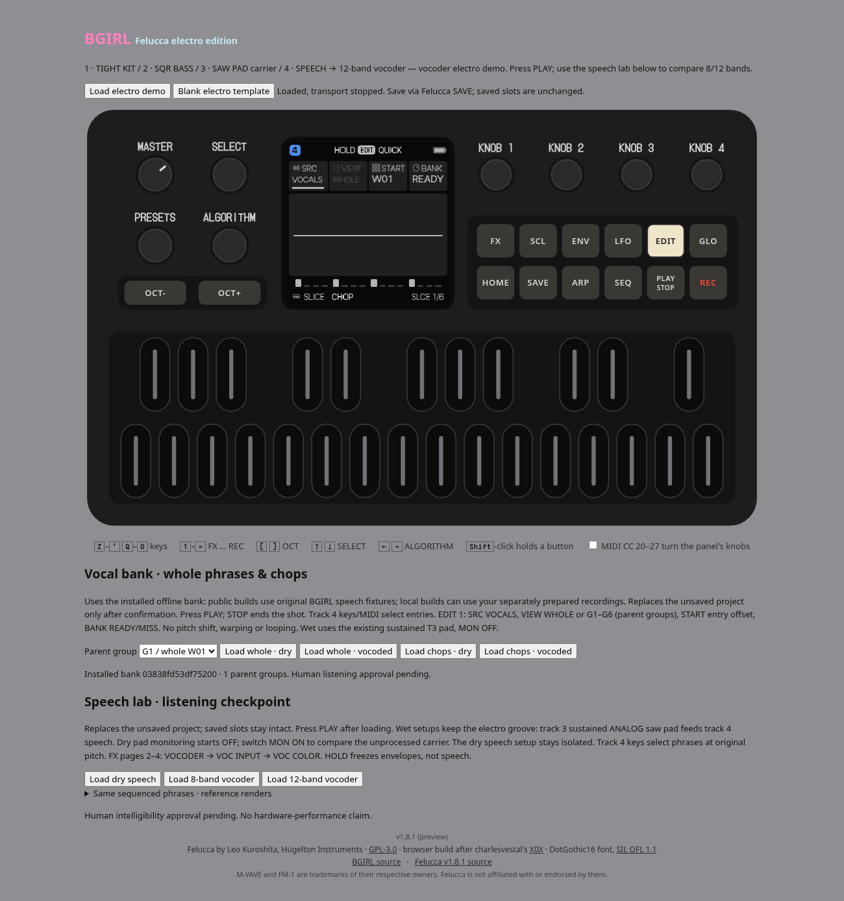

# Offline vocal banks and audition

Issue #13. One optional immutable bank per build, using the existing SLICE
engine/IMA decoder, sequencer, keys, MIDI and vocoder. No network at runtime.
Factory SPEECH and default electro demo are not replaced. Input recordings are
**not licensed for redistribution**: do not commit/upload their WAVs, prepared
banks, listening renders or the WASM that embeds them. Local artifacts belong
in ignored `local/`; CI/Pages builds use the public original-speech fixture.

## Package explicit local inputs

Requires Python 3.11+, standard library only. No ffmpeg, numpy, TTS service or
transient detector. Receive recordings separately on another machine. Missing
files fail clearly; this command never substitutes the fixture.

```sh
python3 tools/package_vocals.py \
  --input-dir /tmp/vocals-for-doug \
  --manifest /tmp/vocals-for-doug/slices/manifest.json \
  --output local/vocal-bank
```

The explicit input directory must contain all manifest parents as
`*_candidate_float.wav`; the manifest's directory must contain exactly its chop
WAVs. The separator-containing reel is not an original. Checks include source /
slice counts, unique paths, containment, contiguous source coverage including tails,
consecutive per-parent slice indices, formats, channels, sample rates, durations,
frame extents, finite samples, 3ms chop-edge metadata, 1..6 parents and 1..32 chops
per parent. Total encoded stream is bounded to 120 seconds at 22.05kHz; this is
an offline sanity bound, **not a claim of available device storage**.

Output: `bank.ima`, `bgirl_vocals.h`, `bank.json`. The JSON includes stable IDs,
parent groups, input SHA256 hashes, original source-frame boundaries, exact
encoded sample offsets/ends/nibbles/durations, entry and grid decoder checkpoints,
audio/header checksums and full bank SHA256. Identity includes conversion version,
audio and manifest provenance; byte-different manifests may change identity
without changing the stable entry mapping. Identical inputs reproduce all outputs.
Keep the prepared bank in a durable ignored folder, not only `/tmp`.

### Conversion / limits

- Input mono/stereo PCM16 or IEEE float32 RIFF WAV, 22050/24000/44100Hz.
- Average stereo channels, no normalization or detection/retrimming. Reject
  NaN/Inf or absolute float values above1.4; fixed -3dB gain accommodates the
  supplied small float overshoot (peak1.0081) without clipping.
- At44.1k, pair-average low-pass then decimate2:1, final odd sample replicated.
  At24k (original public speech source), deterministic linear interpolation;
  22.05k unchanged. This lightweight offline conversion is not studio-grade SRC.
- Preserve full duration (ceil output frames, <1 runtime sample rounding per
  entry). Apply3ms head/tail fades to originals; supplied chops retain their
  existing3ms fades with no second fade/retrim. ADSR/TONE still shape playback.
- One low-nibble-first IMA4 stream with exact entry checkpoints; odd starts are
  valid and recorded. Originals and pre-faded chops use separate portions so
  whole-phrase playback does not inherit internal slice fades.

## Build and serve locally

Activate the pinned Emscripten6.0.10 environment as in README, then:

```sh
BGIRL_VOCAL_BANK="$PWD/local/vocal-bank" ./build.sh --web
./tests/run_tests.sh
python3 -m http.server 8773 --bind 127.0.0.1 --directory felucca/build/emu
```

Open <http://127.0.0.1:8773/> on the server machine. For another computer, tunnel
this loopback-only service (WebAudio needs localhost or trusted HTTPS):

```sh
ssh -N -L 8773:127.0.0.1:8773 USER@BUILD_HOST
# Then open http://127.0.0.1:8773/ on that computer.
```

This is a private local preview, not a release or Pages deployment. The build
embeds private audio into WASM: **do not publish that directory**. Save/load binds
to the first8 bytes of the content SHA256 (full hash retained in bank metadata).
Installing/matching a bank means rebuilding with the same explicit package.
There is no browser upload or hot-swap manager. Audio is compiled read-only, not
copied into a PCM runtime buffer. The prepared bank need not stay on a network.

Default/public builds deliberately regenerate the rights-cleared fixture each
time, even after a private build:

```sh
unset BGIRL_VOCAL_BANK
./build.sh --web
# Or reproduce the fixture package alone:
python3 tools/package_vocals.py --fixture --output local/public-fixture
```

The fixture is existing original speech `assets/speech/source/1.wav` (provenance
and rights in `assets/speech/manifest.json`), kept whole plus two fixed half-file
chops with3ms edge fades. This proves the same path, not Doug's speech quality.



## Listen / normal panel workflow

1. Switch on; use **Vocal bank** below the panel. Installed bank identity/group
   count is shown. Choose a parent; unavailable fixture groups are disabled.
2. **Load whole · dry**, confirm, PLAY. The selected parent's **full original**
   plays once on step1; it repeats only when the64-step pattern returns. STOP
   ends it. No implicit loop. Saved slots remain intact.
3. **Load whole · vocoded** uses the same phrase through the existing12-band
   vocoder and tied sustained T3 saw pad (MON OFF); T1/T2 are muted. PLAY.
4. Repeat with **Load chops · dry/vocoded**: every fourth step triggers the next
   chop in the selected group, wrapping by that group's count. Change global
   BPM60/180 to hear spacing change without altering pitch/duration. A new
   chop can replace a longer previous shot; that is intentional one-voice play.
5. On track4, EDIT1 has SRC / VIEW / START / BANK. VIEW WHOLE selects originals;
   G1..G6 are parent groups. START is a chromatic offset labeled W01… or C01….
   C4+ROOT selects START, higher/lower notes wrap within that view (no transposition).
   OCT+/− changes keyboard octave in the usual way. Every entry is reachable
   from chromatic notes or START; sequencer steps store those same notes. Keys
   and MIDI never change carrier pitch; play T3 separately to supply melody.
6. FX pages2–4 remain VOCODER / VOC INPUT / VOC COLOR. CARR OFF is dry, or use
   existing WET; MON controls **carrier** monitoring only. HOLD still freezes
   envelopes, not speech. No new dry-overlay feature. Hardware MIDI input and
   physical keys remain unverified; host/browser exercise their event paths.

| Private group | Source ID | Whole note (ROOT0/START0) | Chop notes |
| --- | --- | --- | --- |
| G1 | T67_S006 | C4 /60 | C4 onward, group count in bank.json |
| G2 | T71_S010 | C#4 /61 | C4 onward |
| G3 | T72_S009 | D4 /62 | C4 onward |
| G4 | T72_S010 | D#4 /63 | C4 onward |
| G5 | T74_S001 | E4 /64 | C4 onward |
| G6 | T75_S008 | F4 /65 | C4 onward |

MIDI octave labels vary by host: numeric notes60..65 are authoritative. The
private map is sorted source-ID order, chops ordered by numeric slice_index;
filesystem enumeration never sets IDs. `bank.json` identifies every entry.

## Lifetime and saves

A short tap continues through the whole selected entry. Newest trigger restarts /
replaces with the inherited128-frame anti-click transition, no held-note fallback.
MODE/REV/PTCH/DCAY are overridden for vocal one-shots; EDIT2 displays PLAY ONE.
ADSR/TONE/mute/effects still apply. Source/view changes retain captured bounds
for a sounding shot until its end or the next trigger; STOP/panic ends captured
vocals even after source changes, and resets live Freeze. Invalid view / missing
bank replaces a trigger with silence, never a sine or previous valid recording.

Only explicit UI/MIDI/editor SRC edits bind the installed bank. Source automation
and note triggers cannot adopt a different bank. Projects with a VOCALS source
event retain identity even when their base source is BREAK.

Projects retain SRC/VIEW/START/ROOT, note mapping, steps, routing and8-byte bank
identity. Optional-vocal projects use **FUNC**, same3840-byte storage object and
addresses; old firmware refuses FUNC. Non-vocal projects still write FUNB.
FUN1..FUNB readers remain; factory SPEECH stays SRC5, VOCALS appended as SRC6.
Presets save identity in version6 records at packed bytes134..141; older firmware
refuses those records. Presets still clear project-specific CARR and live HOLD.
Raw editor protocol presets without identity safely load missing; use panel
SAVE or full-bank backup to retain identity. A universal bank editor is out of scope.

Load with a missing/different bank stays **BANK MISS** and silent; saving again
preserves the expected identity. It does not adopt the new package. Rebuild with
the correct package, or **explicitly** choose another SRC then VOCALS to bind to
the installed package intentionally. That rebinding changes which recordings a
saved note pattern addresses. Undo sound loads preserves bank identity too.
