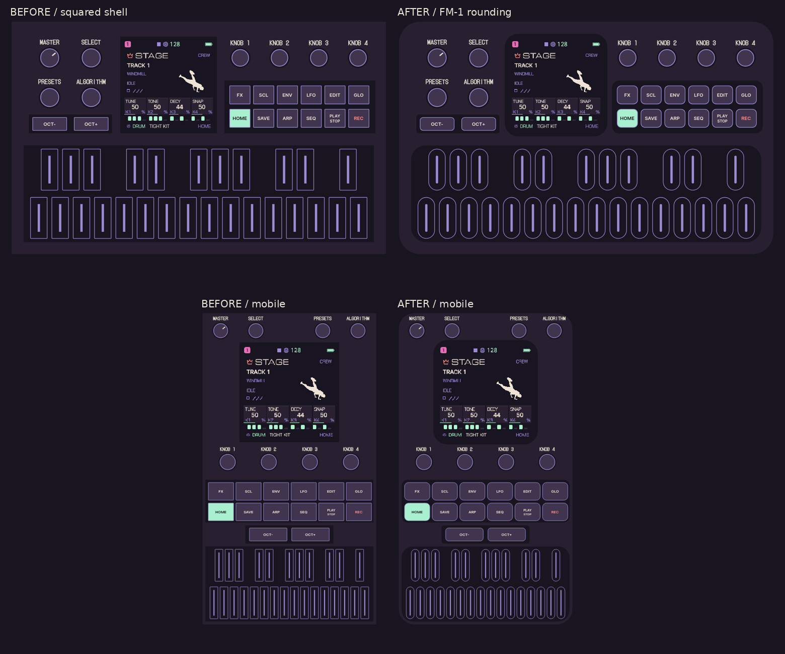
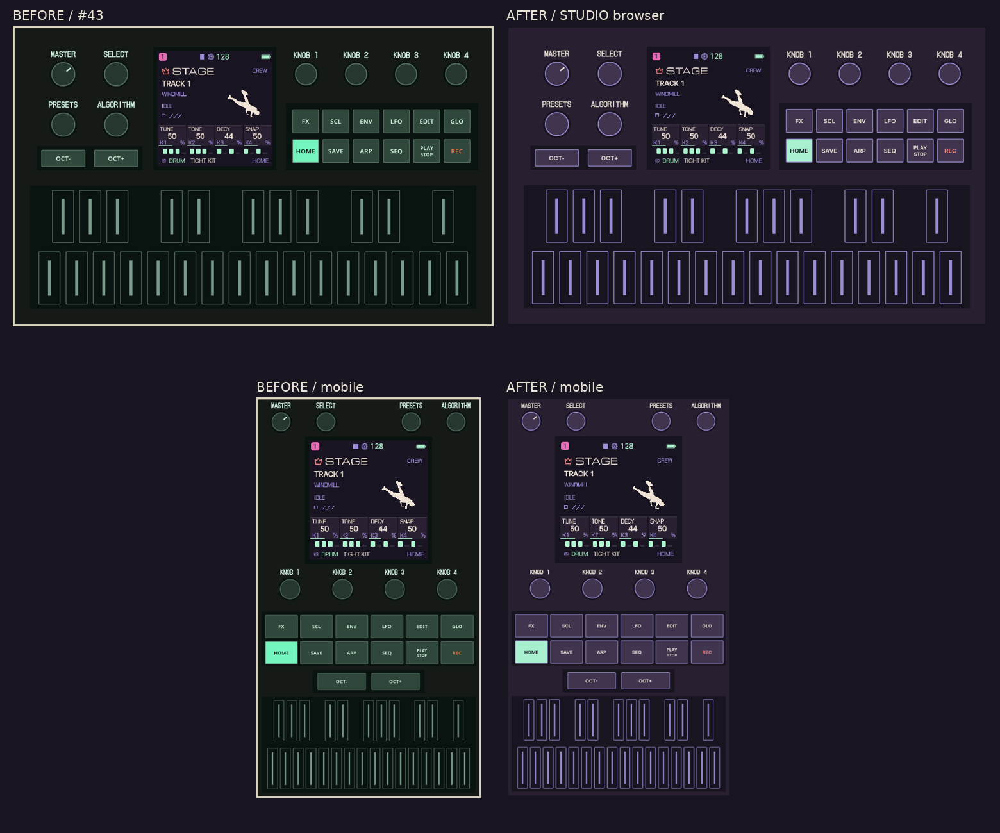

# STUDIO browser shell

Stacks on [PR #43](https://github.com/track-forge/bgirl-fm1/pull/43),
`feat/studio-system-rollout`, exact base
`c0ecb3a42a7926cae986e77e86d23e9240966d1e`.
Doug authorized another stacked PR for browser styling, responsive behavior and
keyboard accessibility. Runtime implementation: `b7373d54c36b5063d11673764f3bec91685dde14`;
later commits include review tooling, documentation, receipts and the explicitly
identified hardware-rounding revision below. No merge, shared preview deployment or hardware work.

## Hardware rounding revision

Doug liked the STUDIO colorway but requested corner profiles closer to his
M-VAVE FM-1 reference. Runtime `cedb7c66aec42fad895d84fa85d3b09fd016c83b`
changes only SVG housing geometry: broad enclosure corners, softly rounded button
wells and buttons, rounded LCD bezel, pill-shaped piano keys and their LED slits.
The startup overlay follows the same enclosure radius. The bezel grows outward
8 SVG units, leaving the actual square display exactly where it was.



[Desktop](../img/browser-shell/rounding/desktop-panel-after.png) /
[mobile](../img/browser-shell/rounding/mobile-panel-after.png) actual Chromium
captures. The supplied hardware photo was a design reference, not copied into
our assets or published in this PR.

[Before/after geometry receipt](../img/browser-shell/rounding/geometry-identity.json)
compares desktop, portrait phone, 320px phone and landscape: **all 49 hit targets,
all STUDIO color variables and the 240×240 canvas dimensions/CSS position are
identical**. The CSS block and all input/audio/storage/MIDI source code are also
byte-identical ([identity receipt](../img/browser-shell/rounding/identity.json)).
No control relocation, firmware rounding, palette, asset, timing
or audio change is included. This deliberately rounds the browser hardware, not
the graph/readout UI drawn inside the LCD.

Latest [focused five-viewport browser checks](../img/browser-shell/rounding/focused-results.json)
and [audio/persistence smoke](../img/browser-shell/rounding/smoke-results.json)
both pass. The [latest full root host/UI/audio run](../img/browser-shell/rounding/host-exit.json)
exits **0**: all 111 goldens unchanged, native/WASM parity and every included
render suite pass; [SYSTEM retains 6,900 clean cases](../img/browser-shell/rounding/system-native.txt).
The [served build identity](../img/browser-shell/rounding/served-identity.json)
also matches the repaired source. The original nineteen-suite browser receipt below belongs to the
initial square-shell revision; it is not relabelled as a nineteen-suite rerun.
Latest browser exits/logs are [recorded separately](../img/browser-shell/rounding/browser-exits.json).
The rounded comparison freezes pre-repair source `1dcbbb6` at local port 8815
against the updated local 8814 build, using the same WASM, fonts and worklet.

## Initial square-shell review (historical)



| View | Before | After |
|---|---|---|
| Desktop, full page | [#43](../img/browser-shell/desktop-before.png) | [STUDIO](../img/browser-shell/desktop-after.png) |
| Mobile, full page | [#43](../img/browser-shell/mobile-before.png) | [STUDIO](../img/browser-shell/mobile-after.png) |
| Desktop panel | [#43](../img/browser-shell/desktop-panel-before.png) | [STUDIO](../img/browser-shell/desktop-panel-after.png) |
| Mobile panel | [#43](../img/browser-shell/mobile-panel-before.png) | [STUDIO](../img/browser-shell/mobile-panel-after.png) |

Actual Chromium screenshots, not mockups. Fresh stopped CREW startup in the same
viewport dimensions; live browser-frame timing is not a pixel-equality assertion.
The 240×240 firmware canvas, native panel layouts and all 49 targets are retained.

## Changes

- Full-RGB STUDIO roles match `felucca/tools/gen_ui_palettes.py`: plum ground,
  bone text, mint actions, lilac rhythm, coral REC and magenta keyboard focus.
  Panel LED state/animation timing is unchanged. Breath colors retain the existing
  firmware-relative HI/LO brightness test and its unchanged tolerances.
- Local Inter Tight body/SVG button type and Chakra Petch section headings match
  the firmware's typography family. Existing DotGothic16 knob labels remain.
  Original graffiti wordmark is shown in its original colors; original PNG and
  provenance are untouched. No remote fonts, analytics or runtime dependencies.
- Instrument and keyboard help precede audition banks/labs in **document order**.
  Original load controls, labels, confirmations, labs, source and licence links
  remain accessible, with no collapsed/hidden audition sections.
- 44px wrapper buttons/selects, wrapping controls/footer, readable phone dropdown
  type and existing portrait panel layout. Panel geometry is deliberately not
  enlarged/remapped; small piano/knob targets on phones remain a limitation.
- Skip link to the labelled instrument region; unpowered panel targets leave the
  tab order. Successful startup focuses HOME; rebuilt portrait/landscape targets
  preserve the previously focused control without a scroll jump.
- On-screen notes now accept Enter/Space, expose pressed state, ignore key repeat
  and release on key-up/focus loss. Focused panel buttons also release on focus
  loss. Orientation/font rebuild releases removed held inputs; pointer-capture
  loss ends encoder dragging. Shift-click latching remains explicit and unchanged.
- Global instrument shortcuts yield to selects, inputs, links, summaries, native
  buttons and editable content, preserving ordinary dropdown navigation/search
  and browser activation. Body/panel keyboard shortcuts retain their old mappings.
- MASTER reports the actual browser-volume value. Relative knobs explicitly
  describe a relative encoder, not a fabricated synth parameter; their numeric
  ARIA position is only the virtual shaft angle. The canvas remains a **visual**
  display, not a spoken screen reader. No full screen-reader/WCAG parity claim.
- Existing reduced-motion LED treatment remains; firmware choreography has its
  separate existing settings. No browser preference silently changes synth settings.

## Verification

**19/19 actual Chromium suites passed** on the initial square-shell revision:
[exit receipt](../img/browser-shell/browser-results.json) /
[per-suite logs](../img/browser-shell/browser-suites.log). Shell, smoke, splash,
vocoder, Mega, demo, vocals, dance, CREW, six-track, SH-ISH, SYSTEM, Signature,
clarity, initial STAGE, LAB, CUT, CUT samples and complete STAGE. Focused/smoke/
splash and the early audio-loader suites were repeated on the final corrected
skin. Served HTML/binaries/fonts/notices/artwork also
[match the local build](../img/browser-shell/served-identity.json).

Focused actual-browser acceptance is `tests/browser-shell.cjs`, also added to the
existing browser-host CI job (no new workflow or deployment trigger).
The final [full host run](../img/browser-shell/host-exit.json) exits **0**:
111 audio goldens unchanged, native/WASM 88,200-frame parity, UI soak,
persistence/MIDI and all included native render suites. The repeated
[SYSTEM native matrix](../img/browser-shell/system-native.txt) retains **6,900
cases / zero findings**. The [source inventory](../img/browser-shell/inventory.txt)
regenerates all 50 definitions with no manifest changes. Independent whole-UI
[layout audit](../img/browser-shell/layout-report.txt) also exits **0**: 233 screens
× 12 palettes, 258,042 values, zero findings/ink/neutral failures;
[334,403 alignment measurements](../img/browser-shell/alignment.txt) all pass.
The eight deliberate lint self-test findings precede the counters' reset; only
production-scene totals are reported as findings, as in #43.

It exercises 1300×1000, 390×844, 320×740, 844×390 and 650×500 CSS viewports;
650×500 is a 200%-equivalent CSS viewport of 1300×1000, **not** an OS-zoom test.

The receipt covers skip/start focus, unpowered tab order, all 49 targets staying
inside the panel, no horizontal overflow, actual AudioWorklet key/button/encoder
messages, dropdown isolation, Enter/Space/repeat/focus-loss note handling, pointer
and touch release, Shift-click latch/unlatch, capture loss, rotation focus,
reduced-motion CSS, main text/control/focus contrast pairs and same-origin assets.
Automated checks do not substitute for Doug's visual/playability or listening lap.

[Focused receipt](../img/browser-shell/focused-results.json),
[build/asset identity](../img/browser-shell/asset-identity.json) and final
host/browser receipts accompany the screenshots. WASM remains **1,069,461 bytes**,
SHA-256 `be56caac9c5730998513a3573619610e78ad6025721e0cd5f4f3f95c299230a0`,
byte-identical to #43; worklet and all four generated firmware UI headers are also
byte-identical. HTML source grows 5,597 bytes; new browser font payload is 55,384
bytes plus notices. No native data/BSS/canvas change is introduced by the wrapper. Early host failure exposed skin breath-level drift; only the
colors were corrected. No test tolerance or golden was changed. The optional clarity gallery was missing
in this new build: its first browser run reached the final gallery request and
failed HTTP 404. Thirty retained STAGE gallery files were then copied byte-for-byte
into the ignored local build, verified by [hash receipt](../img/browser-shell/gallery-fixture.json),
and clarity rerun. No audio/gallery generation or archived-label change occurred. One exploratory
batch invoked a nonexistent `browser-smoke-browser.cjs`; the correct
`tests/browser-smoke.cjs` was run successfully and is the smoke result used here.

## Local review / reproduce

```sh
. /home/dev/.local/share/bgirl-emsdk/emsdk_env.sh
./build.sh --web
./tests/run_tests.sh
# Serve beneath a project path, just like GitHub Pages:
mkdir -p local/browser-shell-site
ln -s ../../felucca/build/emu local/browser-shell-site/bgirl-fm1
python3 -m http.server 8814 --bind 127.0.0.1 --directory local/browser-shell-site
```

In another terminal, with Playwright/Chromium installed:

```sh
export BGIRL_URL=http://127.0.0.1:8814/bgirl-fm1/
# Optional host-specific overrides (not required with standard Playwright):
export PLAYWRIGHT_MODULE=/home/dev/.openclaw/npm/projects/askjo-camofox-browser-2f55486f67/node_modules/playwright-core
export CHROMIUM_PATH=/home/dev/.cache/ms-playwright/chromium-1228/chrome-linux64/chrome
node tests/browser-shell.cjs
node tests/browser-smoke.cjs
node tests/system-browser.cjs
# With the parent review build also running at BGIRL_BEFORE_URL (default :8812):
node tools/browser_shell_review.cjs
```

Local-only review is port 8814, with no service/tailnet changes. The shared 8448
preview and prior slice previews are untouched. Main, dependency pins, generated
firmware fonts/icons/palettes, dancer assets, storage format, DSP and worklet are
unchanged. Physical LCD/RAM/flash/audio-deadline acceptance remains separate.

## Browser font provenance

WOFF subsets are derived from the existing repository fonts, not downloaded.
Source files and original OFL notices remain under `felucca/assets/fonts/`;
matching notices ship beside the WOFFs and are linked in the footer (trailing
whitespace normalized; licence text unchanged).
The new browser fonts total **55,384 bytes** (Inter Tight 43,520; Chakra Petch
11,864). Existing DotGothic16 remains 4,324 bytes. No firmware font changes.

Reproduce from repository root with fonttools' `pyftsubset`:

```sh
pyftsubset 'felucca/assets/fonts/InterTight[wght].ttf' \
  --output-file=felucca/web/emu/fonts/InterTight-latin.woff --flavor=woff \
  --unicodes='U+0020-007E,U+00A0-00FF,U+2010-2027,U+2190-2193,U+2248'
pyftsubset felucca/assets/fonts/ChakraPetch-Medium.ttf \
  --output-file=felucca/web/emu/fonts/ChakraPetch-latin.woff --flavor=woff \
  --unicodes='U+0020-007E,U+00A0-00FF,U+2010-2027,U+2190-2193'
```

Normal browser builds copy the committed WOFFs and notices; no new font-tool
runtime/build dependency is introduced. Outside the subset, ordinary system
fallback applies. No user preset/name content is moved out of the firmware canvas.
