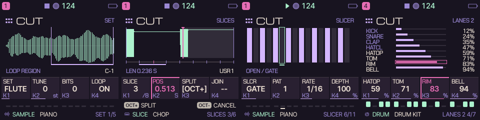

# CUT completion — samples, slices and drum lanes

Stack base: [PR40](https://github.com/track-forge/bgirl-fm1/pull/40),
`feat/studio-cut-sequencing`, frozen at
`39a1b093a63260f6f047b78f7e359e4a63b4dc91`. Doug approved sequencing and authorized
finishing CUT before STAGE as a whole set. No merge or deployment is implied.

## Native review



| Coverage | Normal comparison | LARGE comparison |
|---|---|---|
| SAMPLE and SLICE engine EDIT1/2 | [Sheet1](../img/cut-complete/comparison-normal-1.png) | [Sheet1](../img/cut-complete/comparison-large-1.png) |
| SLICES, END marker, SLICER, LANES2 | [Sheet2](../img/cut-complete/comparison-normal-2.png) | [Sheet2](../img/cut-complete/comparison-large-2.png) |

[Edge-state sheet](../img/cut-complete/edge-states.png). Individual240×240 PNGs
are beside the sheets for1× inspection. Left: frozen PR40, right: this pass;
same fixture/size/STUDIO/FLAT, real RGB565 firmware framebuffers. LINE, light,
mono and every built-in palette are also exercised, not browser approximations.

## What completes CUT

- **SAMPLE EDIT1/2:** the real cached waveform and loop bounds, note/zone identity,
  decoding/missing states and original four knob assignments. LARGE retains the
  waveform plus tall numeric readouts instead of the inherited title-only strip.
- **SLICE EDIT1/2:** CUT identity for source/play pages, including whole/chopped
  VOCALS. The region diagram uses actual existing source bounds and key-to-region
  mapping; no new decoder, audio analyzer or sample editor. Missing bank identity
  stays missing; drawing never binds a different installed bank.
- **SLICES:** original zoomed waveform, selected marker, trimmed head/end,
  whole-source overview, viewport, slice duration, source and SPLIT/JOIN actions.
  Magenta marker and neutral selected region keep mint signal ink legible.
- **SLICER:** actual16-step pattern, GATE depth and STUT repeat hatching; mint
  playback frame/underline distinct from occupied lilac steps, with OFF dim.
  It stays static while stopped even if the internal slicer phase continues.
- **LANES / LANES2:** all eight actual drum levels together; current four-knob
  bank stays identifiable, edited lane magenta, other levels lilac, mute/zero dim.
  Numeric values use the same formatting/units as the knob readouts, not raw MIDI
  counts. Kit-specific names and track/lane mute states remain truthful.

These four remaining source page definitions plus SAMPLE/SLICE variants of the
shared EDIT definitions finish CUT's page coverage alongside approved drum STEP,
melodic STEP/DETAIL/AUTOMATION/SONG. The inventory explicitly marks multiplexed
EDIT1/2 as LAB/CUT, rather than calling the whole engine-dependent row LAB.

Bone text, lilac rhythm/regions, lavender structure, mint signal/playback and
magenta focus continue the approved identity. Existing CUT/crown/vinyl icons and
fonts are unchanged. No controls, navigation IDs, musical modes, preference or
persistence formats, DSP, sample banks or dancer assets change.

**Still separate:** shared hold maps/menus/confirmations/name/browser surfaces are
the system pass; STAGE and wrapper polish remain pending. This is not a new
sample-editing workflow, time stretching or crowned animation. [Rollout ledger](ROLLOUT.md).

## Validation

- Native focused: **3,168 cases**, zero layout/ink/neutrality/alignment/lost findings.
  34 scenes ×12 palettes ×2 sizes ×2 styles, plus1,536 mode/pattern/playhead sweeps.
  Every draw hashes tracks, motion, song config, manual slice tables, vocal bank
  identities and drum mutes before/after: unchanged.
- Independent native checks verify the playback frame at all16 positions in every active-mode
  SLICER pattern and both sizes; stopped phase changes do not invalidate the
  graph, playing phase does, and drum mute/vocal bank changes invalidate it.
- Existing waveform check verifies real IMA decode envelopes, at most512 decoded
  samples per SAMPLE tick, exact lo/hi bins, and untouched audio voices. No new
  decode path or cache was added. SLICES keeps its existing window decoder/cache;
  the512-sample budget is not claimed for that separate decoder.
- Existing UI tests preserve built-in read-only source behavior, actual user-slot
  marker movement, split/join, keys, undo/confirmation/navigation and same-length
  reupload invalidation. Existing saved/custom palettes and restored settings stay
  covered by the unchanged editor/persistence tests.
- Comprehensive renderer still exits nonzero: **378 inherited findings unchanged**;
  exact logged multiset129 →129, zero additions/removals. Zero own-color ink,
  GREY/MONO neutrality or alignment failures. No lint rule/assertion was relaxed.
- Full host/UI/input/persistence/audio suite **PASS, exit0**. All111 audio goldens
  unchanged; zero health/routing/voice/CPU-budget failures. Native/WASM parity
  including heavy-song, Mega, clarity and SH-STYLE PASS. Runtime byte identity is
  recorded with the resource receipt; automated success is not physical-device fit.
- **17/17 Chromium suites PASS**; exit ledger covers17 suites (13 inherited + STAGE + LAB + CUT
  sequencing + CUT samples). New CUT samples acceptance uses real panel engine
  selection and18 edit checks across normal/LARGE, both drum LANES banks and
  SLICER PLAY/STOP, nonzero bounded AudioWorklet output and zero page errors.
  Doug visual/playability approval remains pending.

[Focused before](../img/cut-complete/focused-before.txt) ·
[Focused after](../img/cut-complete/focused-after.txt) ·
[Broad baseline](../img/cut-complete/layout-before.txt) ·
[Broad revised](../img/cut-complete/layout-after.txt) ·
[Exact lint delta](../img/cut-complete/lint-delta.json).

## Resources and redraw costs

[Resource receipt](../img/cut-complete/resources.json) ·
[Asset identity](../img/cut-complete/assets.txt) ·
[Host tests](../img/cut-complete/host-tests.txt) ·
[Browser suites](../img/cut-complete/browser-suites.txt) ·
[Panel interactions](../img/cut-complete/browser-results.json).

Runtime source: `7ff29cdc488969a9933bef6c96565afb24c23de4`.
WASM1,034,067 →1,046,207 bytes (**+12,140 B**), SHA256
`420252f8f8bb6be4c0a5cd25cdb586a77d67bc8510f123fecde3cf0b2b19369b`.
Native host text945,669 →950,501 B (+4,832); data1,596 and BSS1,654,848 unchanged.

Font84,283 B, icons8,753 B and59,520 B canvas are unchanged; generated
font/icon/keycap/palette headers are byte-identical to PR40. No runtime cache,
allocation or persistent structure is added. Exact WASM/host sizes and runtime
revision are in the receipt; these are not device-linker measurements.

[Before draw receipts](../img/cut-complete/draw-before.csv) ·
[After draw receipts](../img/cut-complete/draw-after.csv) ·
[Exact per-recipe delta](../img/cut-complete/draw-delta.json).

64 fresh-process recipes cover eight engine/page combinations ×2 sizes ×idle,
play,100 knob changes and100 track changes. Assertions verify the intended page
is visible and edit/track counters nonzero. SAMPLE and LANES now eliminate the
old periodic oscilloscope redraw after the waveform cache settles. For example,
normal idle:995,520 →0 transferred pixels per44,800 audio frames; playing:
1,068,480 →72,960 (remaining header/footer updates). Stopped SLICER also drops
periodic hidden-playhead redraws to zero. LARGE SLICER playback intentionally
increases72,960 →293,280 pixels because the actual rhythmic diagram now remains
visible instead of a static title strip. 26/64 recipes change; full deltas retain
costs as well as savings. **Counts/areas are not CPU or device transfer timing.**

Optional `FELUCCA_SLICE=0` compile remains blocked by exactly the same two
inherited errors as PR40 (`SLC_SRC_VOCALS` in upreset.c and unguarded `sp` in the
upstream UI test setup); [identical diagnostics](../img/cut-complete/optional-build.txt), no new compile diagnostics. New optional-engine
references are guarded. That guard-only commit leaves the default WASM
byte-identical to25b13ef; no optional-build pass is claimed.

Physical LCD contrast/legibility, transfer/tearing, linker fit/RAM/stack and audio
deadlines remain unverified. No device build/flash, merge or shared-preview deploy.

## Reproduce / local play

```sh
source /home/dev/.local/share/bgirl-emsdk/emsdk_env.sh
./build.sh --web
./tests/run_tests.sh
./tests/run_cut_samples_tests.sh local/cut-complete/after/native
python3 tools/ui_inventory.py
git diff --check
python3 -m http.server 8810 --bind 127.0.0.1 --directory felucca/build/emu
```

Open <http://127.0.0.1:8810>, Switch on. SAVE twice opens PRESETS; K2 selects
SAMPLE, SLICE or DRUM, then EDIT cycles that engine's pages. SLICE's third EDIT
page is SLICES; built-ins remain read-only and USR1–3 retain existing edit actions.
DRUM's EDIT cycle includes LANES and LANES2. FX cycles through SLICER; PLAY shows
its current step. HOME hold → DISPLAY → LARGE retains the chart plus large values
(except the existing label-layout SLICES page). Existing saved palettes win;
choose STUDIO explicitly if needed. Other preview ports are untouched.

```sh
export BGIRL_URL=http://127.0.0.1:8810
export PLAYWRIGHT_MODULE=/home/dev/.npm-global/lib/node_modules/openclaw/node_modules/playwright-core
export CHROMIUM_PATH=/home/dev/.cache/ms-playwright/chromium-1228/chrome-linux64/chrome
node tests/cut-samples-browser.cjs
```

Render/cost fixtures compile with the same native include paths and
`-O1 -ffp-contract=off` as existing runners. For parent comparisons substitute
its absolute ui_render.c/felucca_web.c include and include paths. Define
`BGIRL_CUT_BASELINE` only to omit CUT-specific new pixel/signature assertions;
all common scene/state/layout checks remain. `cut-samples-cost PAGE SIZE` accepts
PAGE0..7, SIZE0..1; invoke each in a fresh process. Broad renderer uses
`-DUI_LINT_LIMIT=12000`; preserve its nonzero exit and exact logged finding ledger.

**Next gate:** Doug's visual/playability review of CUT completion. STAGE can then
be implemented as its own complete set; this PR does not start that rollout.
