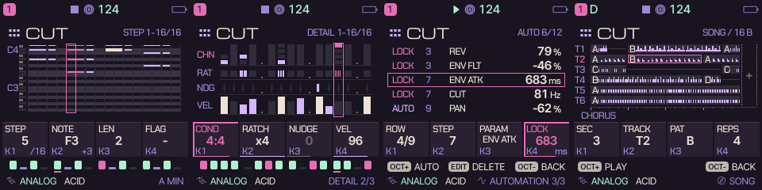

# CUT sequencing — review milestone

Stack base: PR39, `feat/studio-lab-rollout`, exact parent
`52910de468fc4e87a940ea8d076a038bdcd7aa6c`. This is the next focused slice of
issue35; no merge, deployment, release or physical-device build/flash is implied.
Doug approved LAB/inventory/vinyl and authorized this sequencing continuation.

## Native review



[Normal before/after](../img/cut-rollout/comparison-normal.png) ·
[LARGE before/after](../img/cut-rollout/comparison-large.png) ·
[Edge-state contact sheet](../img/cut-rollout/edge-states.png).

Each pair uses the same real-firmware fixture, STUDIO palette, FLAT style and
240×240 RGB565 framebuffer. Left: frozen PR39. Right: this CUT pass. Individual
native PNGs are beside the sheets; the contact sheets do not substitute for
native-size inspection. LINE and all 12 built-in palettes are also rendered.

- **STEP:** compact CUT/page/bank heading, all 21 pitch rows retained at 4px each,
  scale/key strip, actual notes/chords/ties, accent/slide/ratchet/lock marks and
  existing smooth pitch follow. No note range, bank or cursor behavior changes.
- **DETAIL:** CHN/RAT/NDG/VEL lanes, actual chance/conditional/fill states and signed
  nudge values. Inactive or quantized-away information remains dim.
- **AUTOMATION:** five readable, centered scrolling rows instead of seven; same
  underlying order, controls and selected event. Type/step/parameter/value/unit
  retain actual lock/motion/condition/velocity semantics. Header index includes
  PLAY/QNTZ/ADD; the original knob ROW value retains its event-only indexing.
- **SONG:** all six lanes simultaneously visible, actual slot/density summaries,
  merged runs, silent/missing slots, repeat notches, real bar ruler, selected cell,
  playhead, scroll/follow and +ADD. Narrow clipped remnants omit a letter rather
  than overlapping the next block. No invented waveform or extra musical analysis.

Four physical knob labels/values remain on the approved lower readout rail.
LARGE enlarges labels on these existing label-layout pages; it does **not** promise
28px values or silently replace the chart with a title strip. The existing bottom
step strip, navigation/footer, count-in, dialogs, undo and hold layers remain.

## Color semantics

Bone anchors text, lilac carries notes/rhythm/density, lavender structures labels,
magenta frames cursor/focus, mint marks the running playhead, and dim neutrals
identify missing/inactive content. Cursor is a frame; playback is a vertical
stripe plus top dash, so coincident/adjacent states remain distinct by shape as
well as color. The approved CUT icon, STAGE crown and vinyl header are unchanged.
Saved/custom palettes and existing light/mono behavior are not overwritten.

## Scope boundary

Presentation only: ui.c, ui_draw.c, ui_graph.c and the included ui_cut_seq.c.
No new navigation mode, control mapping, DSP, audio, transport, sequencer state,
project format, default preference, dancer asset or animation changes. Existing
SAMPLE/SLICES/SLICER and drum LANES remain a later CUT slice—not a new sample
editor. Remaining STAGE/system/browser-shell work stays in [ROLLOUT](ROLLOUT.md).

## Validation

- Focused native: **2,112 cases**, baseline2,832 → **zero** layout findings;
  zero ink/neutrality/alignment/lost findings.
  28 scenes ×12 palettes ×2 sizes ×2 styles plus768 cursor/playhead bank sweeps.
  Every draw hashes tracks, motion and song configuration before/after: unchanged.
  Pixel readback independently checks magenta frames and mint stripes across all
  64 cursor positions, stopped/coincident/adjacent playback and both sizes.
- Existing screen assertions now use actual graph/readout coordinates. Note/chord/
  tie/rest expectations, six-lane merge/density and song timing/follow tests remain.
  The150,000-frame soak compares actual normal/LARGE knob regions with clean
  forced redraws. Count-in recovery compares the restored graph with a clean draw,
  not two arbitrary pixels that now legitimately contain different graph content.
- Broad renderer: **4,388 →378 findings**, still a nonzero exit. Zero own-color ink,
  GREY/MONO neutrality or alignment failures. Exact logged multiset:2,041 →129,
  **zero additions**,1,912 removals. Report totals include repeated observations;
  the deduplicated ledger is a separate measure, not a contradictory total.
  SONG band checks are updated to the actual six-lane/header/info regions and
  retain bounded text/baseline checks; generic overlap/cell/clipping checks remain.
  The sweep found and fixed scrolled slot-letter overlap; that fixture is now in
  the focused suite. Remaining findings belong to inherited, unmigrated surfaces.
- Physical LCD legibility/contrast, transfer/tearing, linker/stack fit and real-time
  audio deadlines are **not verified** by browser/host measurements.

[Focused native receipt](../img/cut-rollout/focused-after.txt) ·
[Baseline receipt](../img/cut-rollout/focused-before.txt) ·
[Broad baseline](../img/cut-rollout/layout-before.txt) ·
[Broad revised](../img/cut-rollout/layout-after.txt) ·
[Exact lint delta](../img/cut-rollout/lint-delta.json).

## Build, browser and resource receipts

Runtime source: `d062416f34430066c319bd45b3a4f31cb7117d27`.
WASM:1,019,490 →1,034,067 bytes (**+14,577 B**); SHA256
`7f6541d2fe112953d6edbda263f34dfda232bfe24c1203d66a5855424a93ba6d`.
Native host text:939,093 →945,669 bytes (+6,576); data1,596 and BSS1,654,848
unchanged. These are host/WASM measurements, not device linker receipts.

Font84,283 B, icons8,753 B and59,520 B canvas are unchanged. Generated font,
icon, keycap and palette headers are byte-identical to PR39. All32 measured draw
recipes have identical blit counts/areas on both revisions; this does not claim
identical CPU cost or worst-case physical timing.

Final runtime `d062416`: web build and complete host/UI/input/persistence/audio
suite **PASS (exit0)**. All111 audio goldens unchanged; zero health/routing/CPU-budget
failures. Heavy-song, clarity, Mega and SH-STYLE native/WASM parity PASS.
All **16 Chromium suites PASS** (13 inherited + STAGE + LAB + CUT). CUT checks
normal/LARGE, eight actual panel-edit comparisons, saved project/SONG section
creation, nonzero bounded AudioWorklet output and zero page errors. Physical
evidence and Doug's review remain separate from automated test success.

[Host tests](../img/cut-rollout/host-tests.txt) ·
[Browser suites](../img/cut-rollout/browser-suites.txt) ·
[CUT browser interactions](../img/cut-rollout/browser-results.json) ·
[Resources](../img/cut-rollout/resources.json) ·
[Asset identity proof](../img/cut-rollout/assets.txt).

[Before draw receipts](../img/cut-rollout/draw-before.csv) ·
[After draw receipts](../img/cut-rollout/draw-after.csv) ·
[Exact draw delta](../img/cut-rollout/draw-delta.json).

Draw recipes run one fresh host process per page/size, with actual panel encoder
handlers,44,800 audio frames for idle/play and100 edit/track-change iterations.
Assertions verify the intended page is visible and edit/track receipts are
nonzero. Counts are blit areas, **not device timings**. No allocator/cache or new
runtime asset system is introduced.

## Reproduce / play locally

```sh
source /home/dev/.local/share/bgirl-emsdk/emsdk_env.sh
./build.sh --web
./tests/run_tests.sh
./tests/run_cut_tests.sh local/cut-rollout/after/native
python3 tools/ui_inventory.py
git diff --check
python3 -m http.server 8809 --bind 127.0.0.1 --directory felucca/build/emu
```

Open <http://127.0.0.1:8809>, Switch on. ALGORITHM selects T2 ANALOG; slow SEQ taps
cycle STEP → DETAIL → AUTOMATION. GLO opens SONG; existing SAVE → PROJECT controls
save A–D, and K3 on +ADD creates a section. HOME hold → DISPLAY → LARGE exercises
larger labels. Retain existing saved palettes; select STUDIO explicitly if needed.
This server is local-only; existing foundation/LAB/shared preview ports are untouched.

```sh
export BGIRL_URL=http://127.0.0.1:8809
export PLAYWRIGHT_MODULE=/home/dev/.npm-global/lib/node_modules/openclaw/node_modules/playwright-core
export CHROMIUM_PATH=/home/dev/.cache/ms-playwright/chromium-1228/chrome-linux64/chrome
node tests/cut-browser.cjs
```

The full renderer compiles with `-DUI_LINT_LIMIT=12000`. Preserve its nonzero exit
and compare exact `LINT ` multisets excluding only intentional lint self-tests.
For parent compilation, use the same cut-render/cut-cost fixtures with parent
include paths; `BGIRL_CUT_BASELINE` omits only CUT-specific pixel/color assertions.
Compile cut-cost like the renderer and invoke it with page0..3 and size0..1, each
in a fresh process. This avoids carrying prior transport state between recipes.

**Review gate:** Doug's visual/playability review; no automatic next-slice rollout.
