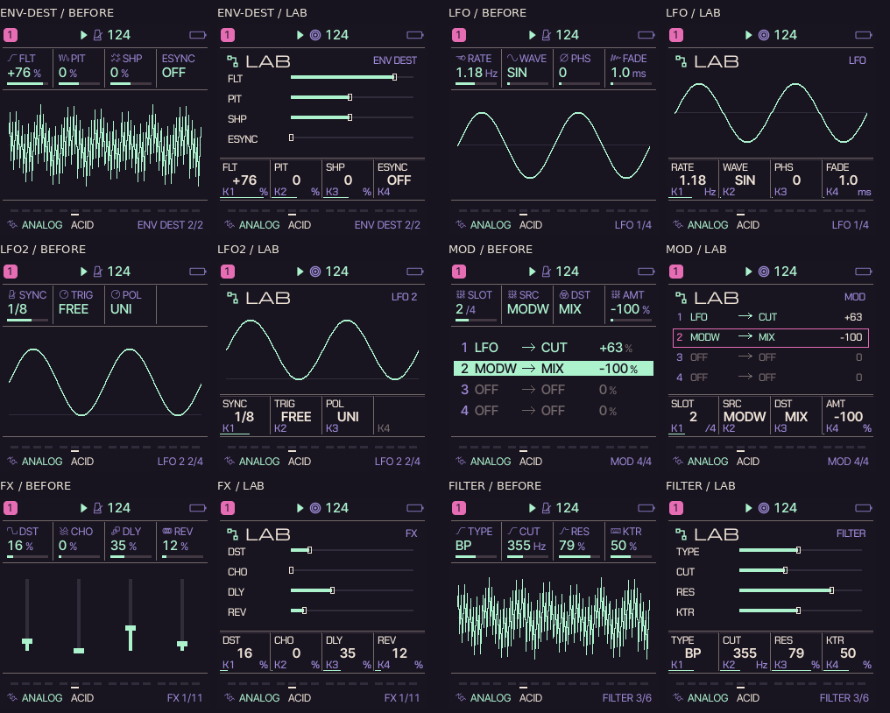

# LAB continuation + vinyl beat marker

Stacked on **PR36**, base `plan/stage-lab-cut` at `3d125b2f9cba4783a8d22a32451f0badcc6fd82c`.
Runtime source: `88066c6`; subsequent commits add tests/docs/evidence only.
Doug approved the foundation, **not yet these new screens**. Stop for image and
playability review. No merge, deployment or device build/flash.

## Inventory and implemented boundary

[Rollout ledger](ROLLOUT.md) · [50 source page definitions](PAGES.md) ·
[machine manifest](pages.json). These are source definitions, not50 distinct
navigation modes: EDIT1/2 have engine-defined labels and layouts; HOME variants,
hold layers, menus and dialogs are additional surfaces in the ledger.

The LAB family contains30 definitions: the approved ENV and FM operator samples,
plus remaining envelope destinations, LFO1/2/destinations, MOD, FX/INSERT/global
sends, vocoder, synth EDIT/FILTER/VOICE and FM OP ENV. Five FM4 compatibility pages
are inventoried but hidden by this build's FM4 feature flag, not physically tested.
SAMPLE's EDIT waveform/controls, SLICES, SLICER and DRUM LANES remain CUT work.
SCL/CHORD/ARP, remaining HOME views, menus and dialogs retain their current layouts.

### What changed

- Reuse the approved graph-first LAB header and four physical knob rails; actual
  page identity stays in the header/footer. No renamed controls/navigation IDs.
- LFO and INSERT use existing parameter-derived curves; OP ENV retains the actual
  selected patch's rates/levels and stage emphasis. FM6 engine pages join the same
  approved topology language. WHEEL retains nine actual drawbar levels and its
  percussion cancellation rather than substituting a generic waveform.
- Other sound controls use labelled **normalized parameter positions**, not a
  frequency-response plot or analyzer. MOD shows all four real routes, with an
  outlined selected slot and DIM inactive routes. Vocoder shows configured
  carrier/band-count/wet routing, HOLD setting and dry-monitor setting; missing or
  busy source is identified, not depicted as a valid signal.
- LARGE retains readable numeric values and the technical diagram, rather than
  collapsing most pages to a title-only strip. It uses the existing bounded
  canvas, no second framebuffer or heap allocation.
- Static diagrams invalidate on their real local/global parameter and carrier
  eligibility inputs, not the old scope's every-other-frame timer. Focus alone
  does not redraw these graphs. No reads of mutable DSP voice state.
- Fonts, palette semantics/IDs, custom colors, saved preferences, physical inputs,
  audio/DSP, timing, data formats, FLOORWORK and ARP animation assets are unchanged.

## Native240×240 comparisons

Each pair is **approved #36 / new LAB**, same fixture and STUDIO LINE style. These
are real firmware RGB565 framebuffers, not browser-only approximations. Native
fixtures use deterministic synthetic input when an inherited scope requires it;
parameter plots and routing diagrams are derived from actual fixture parameters.



[Core LARGE](../img/lab-rollout/comparison-large-1.png) ·
[Engine/INSERT/OP ENV normal](../img/lab-rollout/comparison-normal-2.png) ·
[Engine/INSERT/OP ENV LARGE](../img/lab-rollout/comparison-large-2.png) ·
[Vocoder states and WHEEL normal](../img/lab-rollout/vocoder-wheel-normal.png) ·
[Vocoder states and WHEEL LARGE](../img/lab-rollout/vocoder-wheel-large.png).

Vocoder rows: configured24-band route, HOLD setting, self/missing source, color,
time; final pair is the WHEEL engine. The individual native PNGs alongside these
sheets can be viewed at1×. Human visual/playability approval remains pending.

## Vinyl beat icon


[12/16/24px firmware-decoded specimen](../img/lab-rollout/vinyl-native.png) ·
[2× specimen](../img/lab-rollout/vinyl-2x.png) ·
[Original SVGs and provenance](../../felucca/assets/bgirl-icons/README.md).

Three separately fitted concentric-ring/label drawings append `ICON_BG_VINYL`;
only the header's former metronome glyph changes. Existing TEMPO/TAP icons elsewhere
stay intact. The header's existing stationary behavior is retained—no spinning
animation, metronome-audio, clock or transport changes. Layout measures actual
icon ink, preserving centering, lock spacing, tempo widths and rolling strips.
All159 prior decoded icon cells (including the nine approved section cells) and
all prior IDs are unchanged; the three vinyl cells use the existing alpha4/Huffman
pipeline. Circle support is build-time only, not a new runtime SVG renderer.

## Validation receipts

| Check | Result |
|---|---|
| Web build | PASS, WASM matches the resource receipt |
| Full host/UI/input/persistence/audio suite | PASS, exit0 on runtime88066c6 |
| Audio goldens | 111 unchanged, zero health/routing/CPU-budget failures |
| Native/WASM parity | Heavy-song, clarity, Mega and SH-STYLE PASS |
| CREW preservation | Exact masks/rate/erasure, concurrent publication and512,000-frame audio/RNG checks PASS |
| Focused LAB native | PASS, zero findings/own-color ink/neutrality/alignment/lost measurements |
| Palette and icon checks | PASS, original font bytes and prior icon IDs/alpha preserved |
| Browser | 15/15 PASS:13 existing suites + STAGE + new LAB physical navigation |
| Comprehensive inherited renderer | FAIL unchanged4388; zero added/removed |
| Physical hardware | Not tested |

[Host log](../img/lab-rollout/host-tests.txt) ·
[Browser exits](../img/lab-rollout/browser-suites.txt) ·
[LAB browser results](../img/lab-rollout/browser-results.json) ·
[Native receipt](../img/lab-rollout/focused-after.txt) ·
[Engine/page/size visibility matrix](../img/lab-rollout/visible-pages.tsv).

Local checks are distinct from GitHub exact-head CI; consult the PR checks for
remote status. No CI-green or merge-ready claim is inferred from local results.

The focused native suite renders14 representative scenes in all12 built-in
palettes × normal/LARGE × FLAT/LINE (672 cases), plus24 configured vocoder/state
cases and550 visible engine/page/size combinations (275 engine/page pairs across
25 visible LAB definitions, each normal/LARGE). The visibility/value-bound and configured-vocoder sweeps use STUDIO LINE;
the common14-scene matrix covers all12 palettes and both styles. Each ordinary parameter in
that visibility sweep is also rendered at min/max with knob focus. It checks
clipping, overlap, own-color ink, neutral palettes and alignment without disabling
existing lint rules. Signed values, enums, blank controls, fixed/frequency and
long engine/preset labels use the existing formatting/range-face machinery.

New cache assertions cover idle/focus isolation, local parameter changes, global
send changes and carrier eligibility changes. Existing host tests additionally
cover header ink centering, tempo widths/lock/rolling, stationary beat rendering,
custom palette import/export and saved settings. The browser pass uses real
family buttons/knob sliders and AudioWorklet—not a direct UI setter.

The comprehensive inherited renderer remains **red at4388 findings**, with
exactly zero added/removed findings and zero ink/neutrality/alignment failures; it is not counted
as a passing suite. See [before](../img/lab-rollout/layout-before.txt),
[after](../img/lab-rollout/layout-after.txt), [exact finding delta](../img/lab-rollout/lint-delta.json)
and [alignment receipt](../img/lab-rollout/alignment.txt). Any remaining legacy
findings are still backlog, not normalized into acceptable behavior.

## Costs

| Measurement | Parent#36 | LAB + vinyl | Delta |
|---|---:|---:|---:|
| Fonts | 84,283 B | 84,283 B | 0; generated header byte-identical |
| Icons + codebook | 8,397 B | 8,753 B | +356 B |
| WASM | 1,013,012 B | 1,019,490 B | +6,478 B |
| Host `bgirl_test` text/rodata | 934,965 B | 939,093 B | +4,128 B |
| Host initialized data | 1,596 B | 1,596 B | 0 |
| Host BSS | 1,654,848 B | 1,654,848 B | 0 |
| Canvas | 59,520 B | 59,520 B | 0 |

[Machine resource receipt](../img/lab-rollout/resources.json) ·
[Prior icon compatibility proof](../img/lab-rollout/icon-compatibility.txt).
Final WASM SHA256:
`390ece73037b8bc3264d6cdf2264371defd0d32df6e66853aef999a4c55725e5`.
Host sizes are not device linker-fit measurements. No new persistent state or
heap allocation; target stack/flash fit is unverified.

Forty of80 redraw recipes differ. Normal ENV DEST idle drops from34 blits /
995,520 pixels to0; normal vocoder idle drops from43 /1,077,600 to9 /82,080.
Normal LFO and MOD playback remain8 /72,960. During100 knob turns, LARGE LFO
increases from32 /332,928 to32 /450,048, and LARGE MOD from17 /100,776 to34 /
478,176: the graph remains visible and updates alongside tall readouts instead
of the old static title strip. Other controls legitimately change different
regions; the full per-recipe receipts below retain both improvements and costs.

[Before draw receipts](../img/lab-rollout/draw-before.csv) ·
[After draw receipts](../img/lab-rollout/draw-after.csv) ·
[Exact per-recipe delta](../img/lab-rollout/draw-delta.json).

The80 recipes cover ten actual pages × normal/LARGE × idle/play/100 knob turns/
100 track changes, using44,800 audio frames for steady tests. Track-change receipts
assert nonzero blits/pixels so a disconnected instrumentation hook cannot report
false zero-cost rendering. These are draw counts/areas, **not** CPU or device
transfer timing measurements. LARGE intentionally pays for the retained diagram
and tall readouts while editing, compared with the old title-only strip.

## Reproduce / play locally

```sh
source /home/dev/.local/share/bgirl-emsdk/emsdk_env.sh
./build.sh --web
./tests/run_tests.sh
./tests/run_lab_tests.sh local/lab-rollout/after/lab
python3 tools/ui_inventory.py
python3 tests/test_studio_icons.py
git diff --check
python3 -m http.server 8808 --bind 127.0.0.1 --directory felucca/build/emu
```

Open <http://127.0.0.1:8808>, Switch on. T2 is ANALOG: select with ALGORITHM, cycle
ENV/LFO/EDIT/FX **slowly** so taps do not latch hold layers. T4's existing FX cycle
contains the vocoder pages; T5 is FM6, with EDIT → OPERATOR → OP ENV. Four knobs
retain their actual assignments. HOME hold → DISPLAY → LARGE exercises enlarged
readouts. Existing browser origins retain their saved palette; COLOR → STUDIO
opts in without erasing preferences.

```sh
export BGIRL_URL=http://127.0.0.1:8808
export PLAYWRIGHT_MODULE=/home/dev/.npm-global/lib/node_modules/openclaw/node_modules/playwright-core
export CHROMIUM_PATH=/home/dev/.cache/ms-playwright/chromium-1228/chrome-linux64/chrome
node tests/lab-browser.cjs
node tests/stage-browser.cjs
```

Draw receipts compile `tests/lab-cost.c` with the same firmware/generated include
paths and `-O1 -ffp-contract=off` as the native renderer. Compare with parent#36
in a separate checkout using exactly the same fixture source/compiler options.
For the screenshot fixture on that parent, define `BGIRL_LAB_BASELINE` to omit
new-icon/cache assertions only; all common scene/layout/value-bound checks remain.
The comprehensive renderer uses `-DUI_LINT_LIMIT=12000`; preserve its nonzero exit
and compare exact `LINT ` finding multisets, not total counts alone.

Local8808 is separate from foundation8807 and shared8448. No preview repointing.
Physical LCD color/legibility, target flash/linker/RAM/stack, DMA/tearing and audio
deadlines/xruns remain **not tested**. No hardware readiness or human listening
approval inferred from browser/audio measurements. Issue35 remains open.
