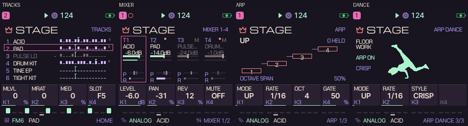

# STAGE completion — native review and verification

Stacks on [PR41](https://github.com/track-forge/bgirl-fm1/pull/41), frozen parent
`82dc8f78479c7832f5ae5949de1d0e55ae97f8a6` / `feat/studio-cut-complete`.
Runtime source: `dcb9ada7a76029755826ff1c2cc0867dcba33b6e`.
No merge, device build/flash, release or shared-preview deployment.
**Technical verification is not Doug's visual/playability approval.**

## Review images

Actual firmware RGB565 rendering at240×240; native-size cells, not HTML mockups.
Each comparison has the same fixture on parent#41 at left and this pass at right.



| Screens | Normal | LARGE |
|---|---|---|
| SCOPE, TRACKS, LEVELS, T5–6 LEVELS | [Comparison1](../img/stage-rollout/comparison-normal-1.png) | [Comparison1](../img/stage-rollout/comparison-large-1.png) |
| MIXER, T5–6 MIXER, CLOCK, ARP | [Comparison2](../img/stage-rollout/comparison-normal-2.png) | [Comparison2](../img/stage-rollout/comparison-large-2.png) |
| ARP2, SCL, CHORD, ARP DANCE | [Comparison3](../img/stage-rollout/comparison-normal-3.png) | [Comparison3](../img/stage-rollout/comparison-large-3.png) |

[Edge states](../img/stage-rollout/edge-states.png) ·
[Native header close-ups](../img/stage-rollout/headers.png).
Individual normal/LARGE native PNGs are alongside the comparison sheets.

## What changed / what stays

- HOME SCOPE retains its actual output snapshot, trigger and auto-normalization;
  now reserves space for the crown/section and output identity. Unknown saved HOME
  values still fall back to SCOPE without overwriting that preference.
- TRACKS and LEVELS retain all six rows, selected-track bank, actual16-step cells,
  64-step bank pips, mute/arm and MIDI activity. Mint playhead stripe/cap is separate
  from lilac occupied steps and magenta selection. LEVELS knobs now identify
  **T1/T2/T3/T4** or **T5/T6/--/--** individually; inactive knobs remain inactive.
- MIXER retains a four-channel bank overview, LEVEL/PAN/REV/MUTE knobs of the
  **selected track**, actual level, pan/reverb indicators and the existing peak
  consumer/decay. It is not four newly mapped level knobs. Bank2 shows T5/T6 and
  two inactive cells; selected and hot controls are separately visible.
- CLOCK shows the existing internal/external source and real16-step bar phase,
  quarter markers and RUN/STOP. No new transport, tap or clock implementation.
- ARP depicts the configured octave span, actual held-note count, mode and gate;
  this diagram is not a fabricated live-note trace. ARP2 gauges use actual
  descriptor ranges. SCL shows the real root/scale mask. CHORD uses actual last
  chord/root or pure chord construction, with OFF/kit/ROOT ONLY states retained.
- ARP DANCE adds section/page identity and CRISP/GHOST/status captions. Its96×96
  mask geometry, FLOORWORK bytes, current-wins ghost composition, event publication,
  coalescing and hidden/idle behavior stay unchanged. Approved CREW HOME is unchanged.
- LARGE keeps102px graphs with64px readouts for SCOPE/MIXER/CLOCK/ARP/SCL/CHORD;
  all six HOME rows and full dance graph retain122px plus label-style readouts.
  All four physical knob identities and actual page navigation remain accessible.
- Bone is the legible foundation; coral marks STAGE/root/performance identity,
  mint carries output/playback, lilac musical structure, lavender supporting text,
  magenta focus, DIM inactive/muted information. Existing theme tokens, palette
  restore/customization and light/mono machinery are reused; no new skin settings.

Two regression-discovered fixes are included: cache a design readout's gauge at
its actual56px quantization (not the legacy50px gauge), and redraw only gaps/header
around cached MIXER/TRACKS cells so forced updates never blank then repaint content.
No added persistent state, canvas, dancer cache or audio-thread work.

## Validation receipts

- [Focused after](../img/stage-rollout/focused-after.txt): **2,576 cases**, zero
  layout, own-ink, neutrality, alignment or lost-measurement findings.37 scenarios
  ×12 palettes ×normal/LARGE ×FLAT/LINE =1,776; plus768 selected-track/bank/playhead
  cases and32 new clock-phase pixel checks. Musical-state hashes exclude only
  MIXER's existing ephemeral peak telemetry; parameters/steps/voices remain covered.
- [Focused parent](../img/stage-rollout/focused-before.txt): the identical fixture,
  parent renderer/headers, **2,544 clean cases**; only new STAGE-specific pixel/cache
  assertions and32 clock-phase pixel checks are omitted with `BGIRL_STAGE_BASELINE`.
- Independent framebuffer assertions cover all six playheads, inactive mixer cells
  and16 clock phases; signature/cache assertions cover held-note changes, stopped
  CLOCK phase isolation, active CLOCK phase and timer-free stopped ARP.
- Full host/UI/audio runner **PASS**: see [log](../img/stage-rollout/host-tests.txt).
  **111 golden renders unchanged**, native/WASM bit-identical, full150,000-frame UI
  soak, forced-redraw/no-flash checks, six-track/input/MIDI/clock, note release,
  project/autosave, vocoder/bank/worker recovery and existing LAB/CUT/CREW tests.
- Dance regression compares every96×96 pixel for12 palettes ×2 display styles
  ×12 poses ×CRISP/GHOST =576 compositions, including erasure/intersections/wrap.
  Geometry assertions now use `graph_y()` and actual STAGE background.512,000 stereo
  frames and4,000 RNG/note snapshots remain identical with telemetry disabled vs
  hidden/CRISP/GHOST. Legacy rolling-card primitives still have full format/direction/
  retarget tests on an explicit synthetic legacy-card page; new STAGE readouts snap
  consistently with the approved design and retain the general UI soak checks.
- Broad renderer still deliberately exits nonzero: **378 inherited findings**,
  no added or removed diagnostic records. [Exact finding multiset delta](../img/stage-rollout/lint-delta.json)
  compares129 logged inherited records, excluding the five self-test lines.
  [Before](../img/stage-rollout/layout-before.txt) / [after](../img/stage-rollout/layout-after.txt):
  zero own-ink/neutrality findings,466,800 alignment measurements, zero off by≥1px;
  258,042 column values and956 FM6 charts swept. This is not a blanket lint pass.
- **18/18 actual Chromium/AudioWorklet suites pass:** [suite exit results](../img/stage-rollout/browser-results.json),
  [STAGE interaction receipt](../img/stage-rollout/browser-stage-results.json),
  [suite logs](../img/stage-rollout/browser-suites.txt). Normal/LARGE, all HOME views,
  real panel navigation/knob edits, bank2 inactive controls, MIXER, CLOCK play/stop,
  ARP/ARP2/DANCE/SCL/CHORD, nonzero bounded live audio, no page errors.
  Existing browser suites separately cover saved/custom palettes and settings.

## Resources and redraw costs

[Machine receipt](../img/stage-rollout/resources.json) · [asset proof](../img/stage-rollout/assets.txt) ·
[36-file dancer SHA manifest](../img/stage-rollout/dancer-assets.json).

| Resource | Parent | STAGE | Delta |
|---|---:|---:|---:|
| Default WASM bytes | 1,046,207 | 1,064,992 | +18,785 |
| Native bgirl_test text bytes | 950,501 | 960,093 | +9,592 |
| Native data / BSS bytes | 1,596 / 1,654,848 | same | 0 |
| Font / icon array bytes | 84,283 / 8,753 | same | 0 |
| Canvas / track / project-wire bytes | 59,520 / 1,856 / 3,840 | same | 0 |

`ui_fonts.h`, `ui_icons.h`, `ui_keycaps.h`, `ui_palettes.h` are byte-identical.
WASM SHA256: `7648f2a69c3617fc013f889923bf044a7ec7cdd51368837158702870cc969e67`.

[Before](../img/stage-rollout/draw-before.csv), [after](../img/stage-rollout/draw-after.csv),
[delta](../img/stage-rollout/draw-delta.json):88 recipes,50 changed. Each of11 page/HOME
contexts ×normal/LARGE runs in a **fresh process**; warm-up then44,800 audio frames
idle/play,100 knob turns ×128 frames,100 track turns ×896 frames. Real nonzero blit
hooks and edit/track assertions; no boot-once reset assumption. These are **host
blitted-pixel counts**, not transfer time, decoder budget, target RAM/stack or xruns.

Normal idle / playback pixels for44,800 frames:

| Context | Parent idle → STAGE | Parent playing → STAGE |
|---|---:|---:|
| SCOPE | 995,520 → 995,520 | 1,068,480 → 1,068,480 |
| TRACKS / LEVELS (each) | 1,813,968 → 0 | 1,886,928 → 242,304 |
| MIXER | 0 → 0 | 997,842 → 736,896 |
| CLOCK | 995,520 → 0 | 1,068,480 → 336,480 |
| ARP / ARP2 (each) | 995,520 → 0 | 1,068,480 → 72,960 |
| SCL / CHORD / idle-ARP DANCE (each) | 0 → 0 | 72,960 → 72,960 |
| CREW cross-check | 0 → 0 | 453,600 → 453,600 |

The ARP DANCE cost scene has no held notes; it does **not** establish animated
worst-case transfer cost. The separate dance regression exercises active events.
Physical LCD contrast, DMA/tearing, linker flash/RAM/stack fit and audio deadlines
remain unverified. Optional `FELUCCA_SLICE=0` is not revalidated here; its two known
inherited compile diagnostics remain documented in the [parent receipt](CUT_COMPLETION_VERIFICATION.md).

## Reproduce / local playability review

```sh
. /home/dev/.local/share/bgirl-emsdk/emsdk_env.sh
./build.sh --web
./tests/run_tests.sh
./tests/run_stage_full_tests.sh
python3 tools/ui_inventory.py
python3 -m http.server 8811 --bind 127.0.0.1 --directory felucca/build/emu
```

Open <http://127.0.0.1:8811>, Switch on. HOME cycles HOME → MIXER → CLOCK;
ARP cycles ARP → ARP2 → ARP DANCE; SCL cycles SCL → CHORD. HOME hold → DISPLAY
row7 selects SCOPE/TRACKS/LEVELS/CREW; row2 toggles LARGE. ALGORITHM chooses
tracks and follows T1–4 / T5–6 banks. Existing origin preferences are respected;
COLOR → STUDIO opts in. Other local preview ports and shared8448 are untouched.

```sh
export BGIRL_URL=http://127.0.0.1:8811
export PLAYWRIGHT_MODULE=/home/dev/.npm-global/lib/node_modules/openclaw/node_modules/playwright-core
export CHROMIUM_PATH=/home/dev/.cache/ms-playwright/chromium-1228/chrome-linux64/chrome
node tests/stage-full-browser.cjs
```

For parent screenshot/cost comparisons compile the same fixtures with its absolute
`ui_render.c` / `felucca_web.c` include and parent include paths. Define
`BGIRL_STAGE_BASELINE` for screenshot baseline only. `stage-full-cost PAGE SIZE`
accepts PAGE0..10, SIZE0..1; invoke each separately. Broad renderer uses
`-DUI_LINT_LIMIT=12000`; preserve its nonzero exit and exact finding multiset.

**Next gate:** Doug's visual/playability review of STAGE. Shared GLO/ENV/LFO/FX/SEQ/
REC hold maps, menus, browsers, naming, confirmations and system overlays remain
in the system pass; browser-shell work follows. See [rollout ledger](ROLLOUT.md).
Issue35 stays open; this PR does not start those remaining slices.
