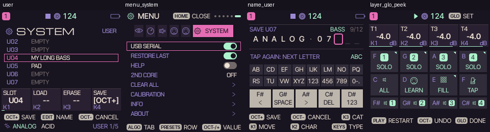

# SYSTEM — remaining firmware UI

Stacked on [PR42](https://github.com/track-forge/bgirl-fm1/pull/42),
`feat/studio-stage-rollout`, exact parent
`c6cc2619153a07a5860eb0cd9832dbc27e197aa3` (including the PAD frame repair).
Doug approved STAGE and authorized this complete SYSTEM pass. Runtime source:
`993edf200aef62649bbd299d039402924c5e710b`; subsequent commits add tests/evidence only.
No merge, shared deployment or physical-device build/flash.

## Actual native screens



| Surface | Normal before/after | LARGE before/after |
|---|---|---|
| USER / PRESETS / PHRASES / PROJECT / TOOLS, occupied/empty/filter states | [Sheet 1](../img/system-rollout/comparison-normal-1.png) | [Sheet 1](../img/system-rollout/comparison-large-1.png) |
| DISPLAY / CONTROL / AUDIO / MIDI / CHANS / SYSTEM, INFO and ABOUT | [Sheet 2](../img/system-rollout/comparison-normal-2.png) | [Sheet 2](../img/system-rollout/comparison-large-2.png) |
| Naming, typing, empty/full, category/random and confirmation dialogs | [Sheet 3](../img/system-rollout/comparison-normal-3.png) | [Sheet 3](../img/system-rollout/comparison-large-3.png) |
| GLO, active/wait FX, SEQ, REC and ENV/LFO momentary pages | [Sheet 4](../img/system-rollout/comparison-normal-4.png) | [Sheet 4](../img/system-rollout/comparison-large-4.png) |

[PROJECT FULL / old-format refusal, native normal/LARGE](../img/system-rollout/project-edge-states.png).
These are real firmware RGB565 output at 240×240, not design mockups.

## Presentation changes and preserved contracts

- Five SAVE-family pages adopt the graph-first SYSTEM heading and four-knob
  register. Slot/preset/pattern identifiers, favourite stars, suggested patterns,
  empty/occupied names, selected action and PROJECT bytes/FULL remain visible.
- Browser lists show **six safely spaced 16px rows**, not seven cramped rows.
  The window follows the existing selection to both ends; no new navigation IDs,
  selection model, control remapping, storage reader/writer or capacity changes.
- Menus keep all **six** tabs (CHANS is separate from MIDI), rows, values, tab
  animation, switches, palette swatches and CALIBRATION/INFO/ABOUT actions.
  Labels and values share measured available space; selection is an outline.
  Normal/dense rows use the existing compact face; LARGE uses M where row height
  permits. The all-values test rejects ellipsised setting labels.
- GLO/EDIT/SCL/FX/SEQ/REC keep their original maps and semantics. Maps use square
  cells on an open canvas; FX's alternating idle columns and held/wait/mute fills
  remain distinct in FLAT/LINE/mono. GLO register names identify T1…T6 individually;
  T5/T6's other two knobs/cells remain inactive. ENV/LFO holds remain their existing
  momentary instrument pages, not invented key maps.
- NAME retains its dedicated bands, 12-character editor, cursor, multi-tap/digits,
  category/random, confirm/cancel, blocked-playing state and physical keys.
  The field/keyboard adopt open/square geometry; CAT is abbreviated in its footer
  so the K3 action's word is not dropped. NAME suppresses the underlying page's
  design context so reopening/closing cannot mix incompatible band geometry.
- Confirmations keep their exact questions, target identifiers, detail and OCT-/+
  choices. Square NO outline / YES fill, warning token and open canvas replace
  floating rounded cards. No destructive action is executed by rendering.
- ABOUT identifies BGIRL and its source, retains upstream version, copyright,
  licences, credits, QR and URLs, and explicitly labels the QR as original Felucca.
  Existing Chakra Petch/Michroma notices are named; no new assets/fonts generated.
- Header messages, MIDI learn, help, count-in, update countdown and calibration
  retain their existing controls/composition; they are audited cross-checks, not
  newly invented workflows. PROJECT FULL and old-format refusal retain their
  notices and preserve live music / stored copies. Browser storage, DSP, MIDI,
  musical RNG, animation/choreography and dependency pins are unchanged.

TOOLS now draws action readiness and focus, so its graph signature includes action,
CLEAN, section count/selection, chain busy state, steps and motion count. Unchanged
idle frames remain suppressed. Actual frame-edge/glyph tests accompany the layout.

## Native and whole-UI verification

[Focused result](../img/system-rollout/focused-after.txt) /
[common parent scenes](../img/system-rollout/focused-before.txt).

- 95 named scenes across 12 palettes × normal/LARGE × FLAT/LINE, plus oversized
  PROJECT/old-format scenes, all menu rows and values, every USER/PROJECT slot,
  restored custom palette/T5–6, all 15 confirmation kinds and all six targets.
- Actual framebuffer borders vs recorded full glyph ink, including dense menus,
  selected slots and confirmation choices. Setting-label truncation is forbidden.
- Hashes of tracks/steps, motion, song chain and stored user/project banks remain
  unchanged by rendering. Oversized save refusal preserves these same hashes.
  The old-format UI fixture models the flag set by NOR discovery (this native
  renderer has FELUCCA_FLASH=0); the real codec/NOR refusal is covered by host tests.
- Overlay exits are compared pixel-for-pixel below the header against the original
  stopped page, not merely checked for calls to clear or a changed signature.
- [Whole-UI baseline](../img/system-rollout/layout-before.txt) →
  [whole-UI result](../img/system-rollout/layout-after.txt): **378 → 0 findings**,
  zero new findings, no baseline waiver. The report intentionally includes eight
  lint self-test failures before counters reset. [Exact logged delta](../img/system-rollout/lint-delta.json)
  excludes those self-tests; the inherited log records 129 distinct finding entries.
- 233 screen scenes × 12 palettes and all page/value/style/LARGE sweeps;
  **258,042 column values**, **334,403 alignment measurements**, 956 FM6 charts;
  zero layout, ink, neutral-palette or alignment failures. 1,673 LARGE knob ranges
  retain a fixed value face, zero size-jumping ranges.
- Only two inherited assertions are adapted: PRESETS' intentionally moved graph/
  readout positions and LINE's intentionally open BG map cells. FX alternation,
  inactive cells, control behavior, persistence and all audio goldens remain tested.

Full host run and final browser receipts are recorded below when complete; GitHub
CI is independently reported against the final PR head, never inferred from local tests.

## Size, assets and redraw receipts

[Machine resources](../img/system-rollout/resources.json) ·
[36-file unchanged dancer manifest](../img/system-rollout/dancer-assets.json) ·
[before draw costs](../img/system-rollout/draw-before.csv) /
[after](../img/system-rollout/draw-after.csv) /
[delta](../img/system-rollout/draw-delta.json).

| Resource | PR42 | SYSTEM |
|---|---:|---:|
| Browser WASM | 1,063,941 B | 1,069,391 B (+5,450) |
| Native bgirl_test text (same compiler/flags) | 960,085 B | 961,837 B (+1,752) |
| Native data / BSS | 1,596 / 1,654,848 B | unchanged |
| Fonts / icons | 84,283 / 8,753 B | unchanged |
| Shared canvas / track / project wire | 59,520 / 1,856 / 3,840 B | unchanged |

Fonts/icons/keycaps/palette generated headers are byte-identical to PR42.
WASM SHA256: `b7057150929b116af87b928a84887b347cbe2e1f09a173f042163c07a7f05c2b`.
No second framebuffer, heap allocation or audio-path work is added.

78 fresh-process redraw recipes cover 13 surfaces × normal/LARGE × three recipes
(idle 44,800 audio frames, forced 896 frames, 100 knob turns ×128 frames).
**3 recipes change**: TOOLS' new action list now repaints on knob/focus changes
(188,556 → 657,036 pixels normal; 246,696 → 657,036 LARGE), and LARGE's forced
TOOLS frame is 54,192 vs 53,472 pixels. All 26 stopped idle recipes transfer zero.
These are firmware blit counts, **not** measured LCD bus time or device CPU budgets.

## Reproduce / playability lap

```sh
. /home/dev/.local/share/bgirl-emsdk/emsdk_env.sh
./build.sh --web
./tests/run_tests.sh
./tests/run_system_tests.sh
python3 tools/ui_inventory.py
python3 -m http.server 8812 --bind 127.0.0.1 --directory felucca/build/emu
```

Open <http://127.0.0.1:8812>, Switch on. SAVE cycles USER → PRESETS → PHRASES →
PROJECT → TOOLS. Knobs/OCT+ retain their normal selection/actions; EDIT renames
occupied USER/PROJECT slots. HOME hold opens MENU; ALGORITHM selects its tab,
PRESETS its row, knobs or OCT-/+ change values. DISPLAY row2 selects LARGE.
Try empty/occupied saves, NAME typing and cancel, and GLO on T1–4 and T5–6.

```sh
export BGIRL_URL=http://127.0.0.1:8812
export PLAYWRIGHT_MODULE=/home/dev/.openclaw/npm/projects/askjo-camofox-browser-2f55486f67/node_modules/playwright-core
export CHROMIUM_PATH=/home/dev/.cache/ms-playwright/chromium-1228/chrome-linux64/chrome
node tests/system-browser.cjs
```

For parent comparison compile the same `system-render.c` with an absolute include
of PR42's `felucca/tests/ui_render.c`, PR42 include paths and
`-DBGIRL_SYSTEM_BASELINE` (skips new frame/cache contracts, not lint). Nonzero parent
lint is expected and preserved. `system-cost PAGE SIZE` takes PAGE0…12 and SIZE0/1;
run each separately. Broad renderer uses `-DUI_LINT_LIMIT=16000` and the same include
paths as the focused runner. Parent broad receipt is retained from exact PR42.

**Review gate:** Doug's visual/playability lap. Browser-shell alignment and a final
whole-UI consistency review follow human approval; hardware contrast/transfer,
linker flash/RAM/stack fit and audio deadlines remain a separate authorization.
Issue35 stays open. Shared preview8448 and all earlier previews remain untouched.
